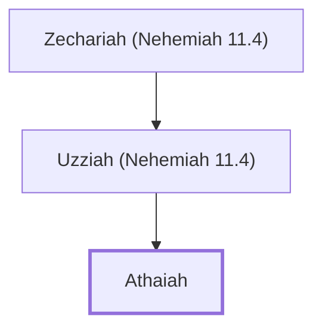

# Athaiah

Descendant of Judah who resettled in Jerusalem

**Original-language names:** עֲתָיָה (H6265)

## When

- **Placed around:** [[connections/timeline/5th century BC|445 BC]] *(Ussher: the median date of the passages naming them)*

## Family

- **Father:** [[connections/people/Uzziah (Nehemiah 11.4)|Uzziah (Nehemiah 11.4)]]

**Line of descent** (6 generations, father to son): [[connections/people/Mahalalel (Nehemiah 11.4)|Mahalalel (Nehemiah 11.4)]] → [[connections/people/Shephatiah (Nehemiah 11.4)|Shephatiah (Nehemiah 11.4)]] → [[connections/people/Amariah (Nehemiah 11.4)|Amariah (Nehemiah 11.4)]] → [[connections/people/Zechariah (Nehemiah 11.4)|Zechariah (Nehemiah 11.4)]] → [[connections/people/Uzziah (Nehemiah 11.4)|Uzziah (Nehemiah 11.4)]] → **Athaiah**

**Family group:** [[connections/genealogy/Family of Mahalalel (Nehemiah 11.4)|Family of Mahalalel (Nehemiah 11.4)]], generation 6

## Appears in

[[connections/chapters/16-nehemiah/Nehemiah 11|Nehemiah 11]]

## Appears in the same verse as

[[connections/people/Amariah (Nehemiah 11.4)|Amariah (Nehemiah 11.4)]] · [[connections/people/Benjamin (Genesis 35.18)|Benjamin (Genesis 35.18)]] · [[connections/people/Judah (Genesis 29.35)|Judah (Genesis 29.35)]] · [[connections/people/Mahalalel (Nehemiah 11.4)|Mahalalel (Nehemiah 11.4)]] · [[connections/people/Perez|Perez]] · [[connections/people/Shephatiah (Nehemiah 11.4)|Shephatiah (Nehemiah 11.4)]] · [[connections/people/Uzziah (Nehemiah 11.4)|Uzziah (Nehemiah 11.4)]] · [[connections/people/Zechariah (Nehemiah 11.4)|Zechariah (Nehemiah 11.4)]] · [[connections/places/Jerusalem|Jerusalem]]
