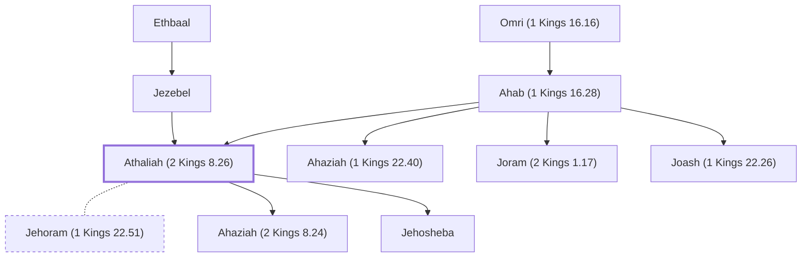

# Athaliah (2 Kings 8.26)

Queen of Judah, daughter of Ahab and Jezebel

**Original-language names:** עֲתַלְיָ֫הוּ (H6271)

## When

- **Lived:** ? – [[connections/timeline/9th century BC|879 BC]] *(Jones)*
- **Placed around:** [[connections/timeline/9th century BC|884 BC]] *(Ussher: the median date of the passages naming them)*

## Family

- **Father:** [[connections/people/Ahab (1 Kings 16.28)|Ahab (1 Kings 16.28)]]
- **Mother:** [[connections/people/Jezebel|Jezebel (uncertain)]]
- **Brothers and sisters:** [[connections/people/Ahaziah (1 Kings 22.40)|Ahaziah (1 Kings 22.40)]], [[connections/people/Joram (2 Kings 1.17)|Joram (2 Kings 1.17)]], [[connections/people/Joash (1 Kings 22.26)|Joash (1 Kings 22.26)]]
- **Spouses:** [[connections/people/Jehoram (1 Kings 22.51)|Jehoram (1 Kings 22.51)]]
- **Children:** [[connections/people/Ahaziah (2 Kings 8.24)|Ahaziah (2 Kings 8.24)]], [[connections/people/Jehosheba|Jehosheba]]

**Line of descent** (3 generations, father to son): [[connections/people/Omri (1 Kings 16.16)|Omri (1 Kings 16.16)]] → [[connections/people/Ahab (1 Kings 16.28)|Ahab (1 Kings 16.28)]] → **Athaliah (2 Kings 8.26)**

**Family group:** [[connections/genealogy/Family of Adam|Family of Adam]], generation 3

## Events

- [[connections/timeline/9th century BC|886 BC]] · [[connections/events/Reign of Athaliah|Reign of Athaliah]]

## Appears in

[[connections/chapters/12-2-kings/2 Kings 8|2 Kings 8]] · [[connections/chapters/12-2-kings/2 Kings 11|2 Kings 11 (6)]] · [[connections/chapters/14-2-chronicles/2 Chronicles 22|2 Chronicles 22 (4)]] · [[connections/chapters/14-2-chronicles/2 Chronicles 23|2 Chronicles 23 (3)]] · [[connections/chapters/14-2-chronicles/2 Chronicles 24|2 Chronicles 24]]

## Appears in the same verse as

[[connections/people/Ahaziah (2 Kings 8.24)|Ahaziah (2 Kings 8.24) (6)]] · [[connections/people/Jehoram (1 Kings 22.51)|Jehoram (1 Kings 22.51) (2)]] · [[connections/people/Jehosheba|Jehosheba (2)]] · [[connections/people/Joash (2 Kings 11.2)|Joash (2 Kings 11.2) (2)]] · [[connections/people/Omri (1 Kings 16.16)|Omri (1 Kings 16.16) (2)]] · [[connections/places/Jerusalem|Jerusalem (2)]] · [[connections/people/Israel|Israel]] · [[connections/people/Jehoiada (2 Kings 11.4)|Jehoiada (2 Kings 11.4)]] · [[connections/people/Judah (Genesis 29.35)|Judah (Genesis 29.35)]]
