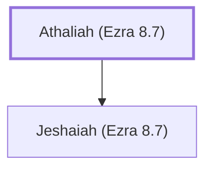

# Athaliah (Ezra 8.7)

Descendant of Elam who returned from Babylonian exile

**Original-language names:** עֲתַלְיָ֫הוּ (H6271)

## When

- **Placed around:** [[connections/timeline/5th century BC|457 BC]] *(Ussher: the median date of the passages naming them)*

## Family

- **Children:** [[connections/people/Jeshaiah (Ezra 8.7)|Jeshaiah (Ezra 8.7)]]

**Family group:** [[connections/genealogy/Family of Athaliah (Ezra 8.7)|Family of Athaliah (Ezra 8.7)]], generation 1

## Appears in

[[connections/chapters/15-ezra/Ezra 8|Ezra 8]]

## Appears in the same verse as

[[connections/people/Elam (Ezra 2.7)|Elam (Ezra 2.7)]] · [[connections/people/Jeshaiah (Ezra 8.7)|Jeshaiah (Ezra 8.7)]]
