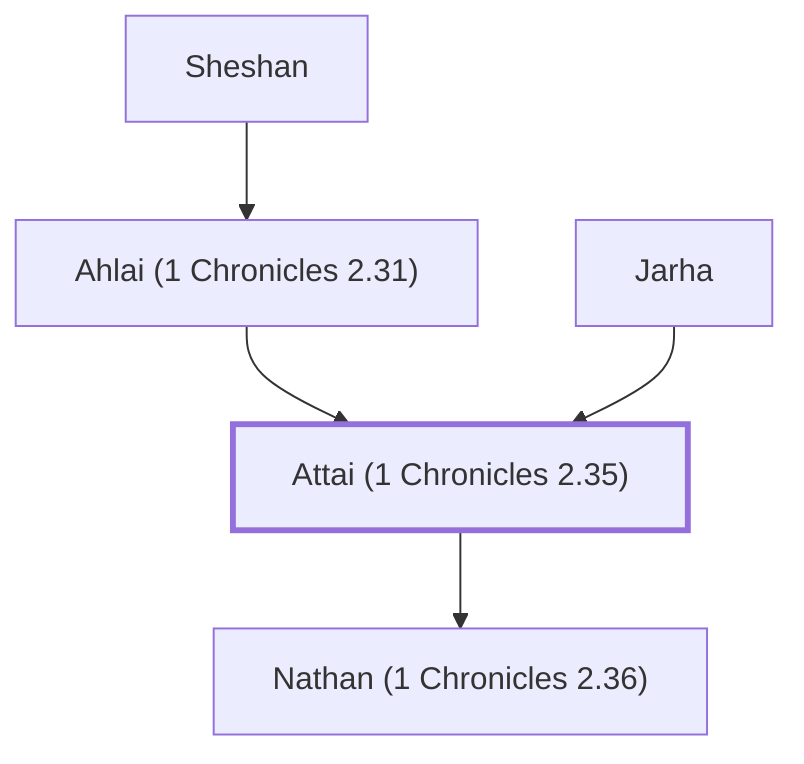

# Attai (1 Chronicles 2.35)

Grandson of Sheshan, descendant of Judah

**Original-language names:** עַתַּי (H6262)

## When

- **Placed around:** [[connections/timeline/15th century BC|1470 BC]] *(Ussher: the median date of the passages naming them)*

## Family

- **Father:** [[connections/people/Jarha|Jarha]]
- **Mother:** [[connections/people/Ahlai (1 Chronicles 2.31)|Ahlai (1 Chronicles 2.31)]]
- **Children:** [[connections/people/Nathan (1 Chronicles 2.36)|Nathan (1 Chronicles 2.36)]]
- **Tribe or nation:** Tribe of Judah

**Family group:** [[connections/genealogy/Family of Ishi (1 Chronicles 2.31)|Family of Ishi (1 Chronicles 2.31)]], generation 4

## Appears in

[[connections/chapters/13-1-chronicles/1 Chronicles 2|1 Chronicles 2 (2)]]

## Appears in the same verse as

[[connections/people/Jarha|Jarha]] · [[connections/people/Nathan (1 Chronicles 2.36)|Nathan (1 Chronicles 2.36)]] · [[connections/people/Sheshan|Sheshan]] · [[connections/people/Zabad (1 Chronicles 2.36)|Zabad (1 Chronicles 2.36)]]
