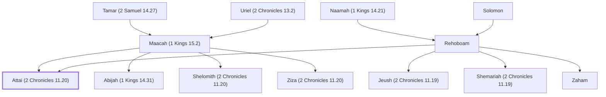

# Attai (2 Chronicles 11.20)

Son of King Rehoboam and Maacah

**Original-language names:** עַתַּי (H6262)

## When

- **Placed around:** [[connections/timeline/10th century BC|975 BC]] *(Ussher: the median date of the passages naming them)*

## Family

- **Father:** [[connections/people/Rehoboam|Rehoboam]]
- **Mother:** [[connections/people/Maacah (1 Kings 15.2)|Maacah (1 Kings 15.2)]]
- **Brothers and sisters:** [[connections/people/Abijah (1 Kings 14.31)|Abijah (1 Kings 14.31)]], [[connections/people/Jeush (2 Chronicles 11.19)|Jeush (2 Chronicles 11.19)]], [[connections/people/Shelomith (2 Chronicles 11.20)|Shelomith (2 Chronicles 11.20)]], [[connections/people/Shemariah (2 Chronicles 11.19)|Shemariah (2 Chronicles 11.19)]], [[connections/people/Zaham|Zaham]], [[connections/people/Ziza (2 Chronicles 11.20)|Ziza (2 Chronicles 11.20)]]
- **Tribe or nation:** Tribe of Judah

**Line of descent** (37 generations, father to son): [[connections/people/Adam|Adam]] → [[connections/people/Seth|Seth]] → [[connections/people/Enosh|Enosh]] → [[connections/people/Kenan|Kenan]] → [[connections/people/Mahalalel (Genesis 5.12)|Mahalalel (Genesis 5.12)]] → [[connections/people/Jared|Jared]] → [[connections/people/Enoch (Genesis 5.18)|Enoch (Genesis 5.18)]] → [[connections/people/Methuselah|Methuselah]] → [[connections/people/Lamech (Genesis 5.25)|Lamech (Genesis 5.25)]] → [[connections/people/Noah (Genesis 5.29)|Noah (Genesis 5.29)]] → [[connections/people/Shem|Shem]] → [[connections/people/Arpachshad|Arpachshad]] → [[connections/people/Cainan|Cainan]] → [[connections/people/Shelah (Genesis 10.24)|Shelah (Genesis 10.24)]] → [[connections/people/Eber (Genesis 10.21)|Eber (Genesis 10.21)]] → [[connections/people/Peleg|Peleg]] → [[connections/people/Reu|Reu]] → [[connections/people/Serug|Serug]] → [[connections/people/Nahor (Genesis 11.22)|Nahor (Genesis 11.22)]] → [[connections/people/Terah|Terah]] → [[connections/people/Abraham|Abraham]] → [[connections/people/Isaac|Isaac]] → [[connections/people/Israel|Israel]] → [[connections/people/Judah (Genesis 29.35)|Judah (Genesis 29.35)]] → [[connections/people/Perez|Perez]] → [[connections/people/Hezron (Genesis 46.12)|Hezron (Genesis 46.12)]] → [[connections/people/Ram (Ruth 4.19)|Ram (Ruth 4.19)]] → [[connections/people/Amminadab (Exodus 6.23)|Amminadab (Exodus 6.23)]] → [[connections/people/Nahshon|Nahshon]] → [[connections/people/Salmon|Salmon]] → [[connections/people/Boaz|Boaz]] → [[connections/people/Obed (Ruth 4.17)|Obed (Ruth 4.17)]] → [[connections/people/Jesse|Jesse]] → [[connections/people/David|David]] → [[connections/people/Solomon|Solomon]] → [[connections/people/Rehoboam|Rehoboam]] → **Attai (2 Chronicles 11.20)**

**Family group:** [[connections/genealogy/Family of Adam|Family of Adam]], generation 37

## Appears in

[[connections/chapters/14-2-chronicles/2 Chronicles 11|2 Chronicles 11]]

## Appears in the same verse as

[[connections/people/Abijah (1 Kings 14.31)|Abijah (1 Kings 14.31)]] · [[connections/people/Absalom|Absalom]] · [[connections/people/Maacah (1 Kings 15.2)|Maacah (1 Kings 15.2)]] · [[connections/people/Shelomith (2 Chronicles 11.20)|Shelomith (2 Chronicles 11.20)]] · [[connections/people/Ziza (2 Chronicles 11.20)|Ziza (2 Chronicles 11.20)]]
