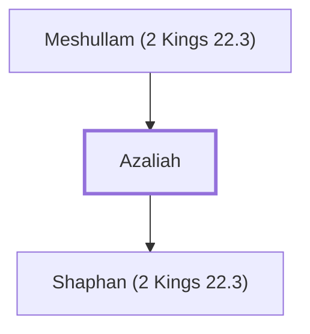

# Azaliah

Father of Shaphan the scribe during Josiah's reign

**Original-language names:** אֲצַלְיָ֫הוּ (H0683)

## When

- **Placed around:** [[connections/timeline/7th century BC|624 BC]] *(Ussher: the median date of the passages naming them)*

## Family

- **Father:** [[connections/people/Meshullam (2 Kings 22.3)|Meshullam (2 Kings 22.3)]]
- **Children:** [[connections/people/Shaphan (2 Kings 22.3)|Shaphan (2 Kings 22.3)]]

**Family group:** [[connections/genealogy/Family of Meshullam (2 Kings 22.3)|Family of Meshullam (2 Kings 22.3)]], generation 2

## Appears in

[[connections/chapters/12-2-kings/2 Kings 22|2 Kings 22]] · [[connections/chapters/14-2-chronicles/2 Chronicles 34|2 Chronicles 34]]

## Appears in the same verse as

[[connections/people/Shaphan (2 Kings 22.3)|Shaphan (2 Kings 22.3) (2)]] · [[connections/people/Joah (2 Chronicles 34.8)|Joah (2 Chronicles 34.8)]] · [[connections/people/Joahaz|Joahaz]] · [[connections/people/Josiah (1 Kings 13.2)|Josiah (1 Kings 13.2)]] · [[connections/people/Maaseiah (2 Chronicles 34.8)|Maaseiah (2 Chronicles 34.8)]] · [[connections/people/Meshullam (2 Kings 22.3)|Meshullam (2 Kings 22.3)]]
