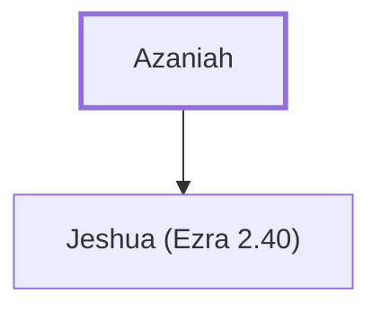

# Azaniah

One of the Levites who sealed the covenant

**Original-language names:** אֲזַנְיָ֫הוּ (H0245)

## When

- **Placed around:** [[connections/timeline/5th century BC|445 BC]] *(Ussher: the median date of the passages naming them)*

## Family

- **Children:** [[connections/people/Jeshua (Ezra 2.40)|Jeshua (Ezra 2.40)]]

**Family group:** [[connections/genealogy/Family of Azaniah|Family of Azaniah]], generation 1

## Appears in

[[connections/chapters/16-nehemiah/Nehemiah 10|Nehemiah 10]]

## Appears in the same verse as

[[connections/people/Bani (Nehemiah 8.7)|Bani (Nehemiah 8.7)]] · [[connections/people/Henadad (Ezra 3.9)|Henadad (Ezra 3.9)]] · [[connections/people/Jeshua (Ezra 2.40)|Jeshua (Ezra 2.40)]] · [[connections/people/Kadmiel|Kadmiel]]
