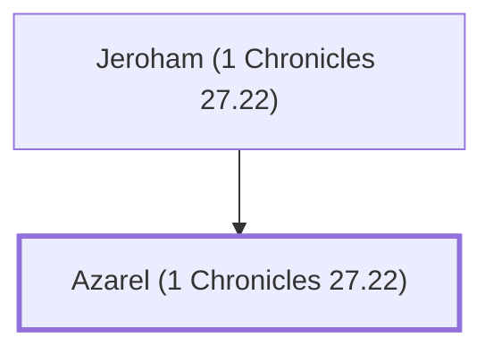

# Azarel (1 Chronicles 27.22)

Leader of the half-tribe of Manasseh under David

**Original-language names:** עֲזַרְאֵל (H5832)

## When

- **Placed around:** [[connections/timeline/11th century BC|1015 BC]] *(Ussher: the median date of the passages naming them)*

## Family

- **Father:** [[connections/people/Jeroham (1 Chronicles 27.22)|Jeroham (1 Chronicles 27.22)]]

**Family group:** [[connections/genealogy/Family of Jeroham (1 Chronicles 27.22)|Family of Jeroham (1 Chronicles 27.22)]], generation 2

## Appears in

[[connections/chapters/13-1-chronicles/1 Chronicles 27|1 Chronicles 27]]

## Appears in the same verse as

[[connections/people/Israel|Israel]] · [[connections/people/Jeroham (1 Chronicles 27.22)|Jeroham (1 Chronicles 27.22)]] · [[connections/places/Dan|Dan]]
