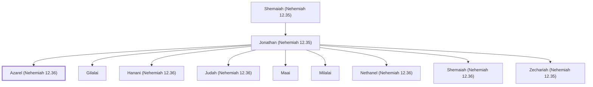

# Azarel (Nehemiah 12.36)

Priest who participated in the dedication of Jerusalem's wall

**Original-language names:** עֲזַרְאֵל (H5832)

## When

- **Placed around:** [[connections/timeline/5th century BC|445 BC]] *(Ussher: the median date of the passages naming them)*

## Family

- **Father:** [[connections/people/Jonathan (Nehemiah 12.35)|Jonathan (Nehemiah 12.35)]]
- **Brothers and sisters:** [[connections/people/Gilalai|Gilalai]], [[connections/people/Hanani (Nehemiah 12.36)|Hanani (Nehemiah 12.36)]], [[connections/people/Judah (Nehemiah 12.36)|Judah (Nehemiah 12.36)]], [[connections/people/Maai|Maai]], [[connections/people/Milalai|Milalai]], [[connections/people/Nethanel (Nehemiah 12.36)|Nethanel (Nehemiah 12.36)]], [[connections/people/Shemaiah (Nehemiah 12.36)|Shemaiah (Nehemiah 12.36)]], [[connections/people/Zechariah (Nehemiah 12.35)|Zechariah (Nehemiah 12.35)]]

**Line of descent** (5 generations, father to son): [[connections/people/Mica (Nehemiah 11.22)|Mica (Nehemiah 11.22)]] → [[connections/people/Mattaniah (Nehemiah 11.22)|Mattaniah (Nehemiah 11.22)]] → [[connections/people/Shemaiah (Nehemiah 12.35)|Shemaiah (Nehemiah 12.35)]] → [[connections/people/Jonathan (Nehemiah 12.35)|Jonathan (Nehemiah 12.35)]] → **Azarel (Nehemiah 12.36)**

**Family group:** [[connections/genealogy/Family of Mica (Nehemiah 11.22)|Family of Mica (Nehemiah 11.22)]], generation 5

## Appears in

[[connections/chapters/16-nehemiah/Nehemiah 12|Nehemiah 12]]

## Appears in the same verse as

[[connections/people/David|David]] · [[connections/people/Ezra (Ezra 7.1)|Ezra (Ezra 7.1)]] · [[connections/people/Gilalai|Gilalai]] · [[connections/people/Hanani (Nehemiah 12.36)|Hanani (Nehemiah 12.36)]] · [[connections/people/Judah (Nehemiah 12.36)|Judah (Nehemiah 12.36)]] · [[connections/people/Maai|Maai]] · [[connections/people/Milalai|Milalai]] · [[connections/people/Nethanel (Nehemiah 12.36)|Nethanel (Nehemiah 12.36)]] · [[connections/people/Shemaiah (Nehemiah 12.36)|Shemaiah (Nehemiah 12.36)]]
