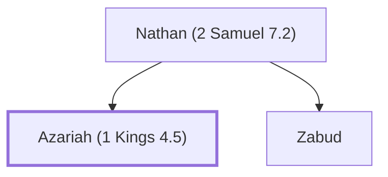

# Azariah (1 Kings 4.5)

Son of Nathan, an official in Solomon's court

**Original-language names:** עֲזַרְיָ֫הוּ (H5838)

## When

- **Placed around:** [[connections/timeline/11th century BC|1014 BC]] *(Ussher: the median date of the passages naming them)*

## Family

- **Father:** [[connections/people/Nathan (2 Samuel 7.2)|Nathan (2 Samuel 7.2)]]
- **Brothers and sisters:** [[connections/people/Zabud|Zabud]]

**Family group:** [[connections/genealogy/Family of Nathan (2 Samuel 7.2)|Family of Nathan (2 Samuel 7.2)]], generation 2

## Appears in

[[connections/chapters/11-1-kings/1 Kings 4|1 Kings 4]]

## Appears in the same verse as

[[connections/people/Nathan (2 Samuel 7.2)|Nathan (2 Samuel 7.2)]] · [[connections/people/Zabud|Zabud]]
