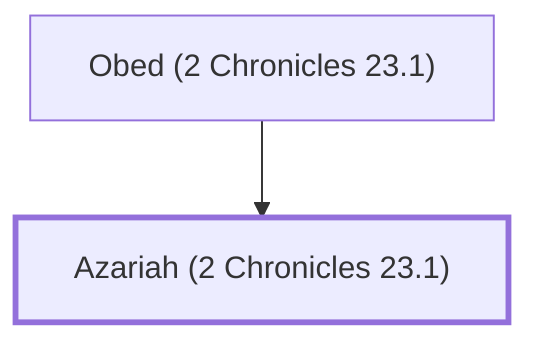

# Azariah (2 Chronicles 23.1)

A commander who supported Joash's coronation

**Original-language names:** עֲזַרְיָ֫הוּ (H5838)

## When

- **Placed around:** [[connections/timeline/9th century BC|878 BC]] *(Ussher: the median date of the passages naming them)*

## Family

- **Father:** [[connections/people/Obed (2 Chronicles 23.1)|Obed (2 Chronicles 23.1)]]
- **Tribe or nation:** Tribe of Levi

**Family group:** [[connections/genealogy/Family of Obed (2 Chronicles 23.1)|Family of Obed (2 Chronicles 23.1)]], generation 2

## Appears in

[[connections/chapters/14-2-chronicles/2 Chronicles 23|2 Chronicles 23]]

## Appears in the same verse as

[[connections/people/Adaiah (2 Chronicles 23.1)|Adaiah (2 Chronicles 23.1)]] · [[connections/people/Azariah (2 Chronicles 23.1)|Azariah (2 Chronicles 23.1)]] · [[connections/people/Elishaphat|Elishaphat]] · [[connections/people/Ishmael (2 Chronicles 23.1)|Ishmael (2 Chronicles 23.1)]] · [[connections/people/Jehohanan (2 Chronicles 23.1)|Jehohanan (2 Chronicles 23.1)]] · [[connections/people/Jehoiada (2 Kings 11.4)|Jehoiada (2 Kings 11.4)]] · [[connections/people/Jeroham (2 Chronicles 23.1)|Jeroham (2 Chronicles 23.1)]] · [[connections/people/Maaseiah (2 Chronicles 23.1)|Maaseiah (2 Chronicles 23.1)]] · [[connections/people/Obed (2 Chronicles 23.1)|Obed (2 Chronicles 23.1)]] · [[connections/people/Zichri (2 Chronicles 23.1)|Zichri (2 Chronicles 23.1)]]
