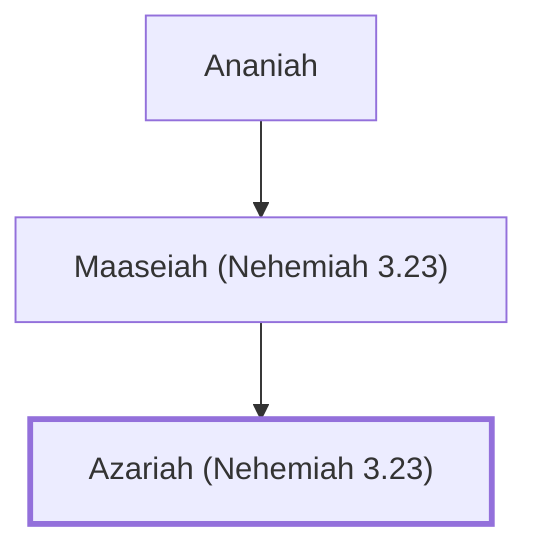

# Azariah (Nehemiah 3.23)

Son of Maaseiah, repairer of Jerusalem's wall

**Original-language names:** עֲזַרְיָה (H5838)

## When

- **Placed around:** [[connections/timeline/5th century BC|445 BC]] *(Ussher: the median date of the passages naming them)*

## Family

- **Father:** [[connections/people/Maaseiah (Nehemiah 3.23)|Maaseiah (Nehemiah 3.23)]]

**Line of descent** (3 generations, father to son): [[connections/people/Ananiah|Ananiah]] → [[connections/people/Maaseiah (Nehemiah 3.23)|Maaseiah (Nehemiah 3.23)]] → **Azariah (Nehemiah 3.23)**

**Family group:** [[connections/genealogy/Family of Ananiah|Family of Ananiah]], generation 3

## Appears in

[[connections/chapters/16-nehemiah/Nehemiah 3|Nehemiah 3 (2)]]

## Appears in the same verse as

[[connections/people/Ananiah|Ananiah]] · [[connections/people/Benjamin (Nehemiah 3.23)|Benjamin (Nehemiah 3.23)]] · [[connections/people/Binnui (Nehemiah 3.24)|Binnui (Nehemiah 3.24)]] · [[connections/people/Hasshub (Nehemiah 3.23)|Hasshub (Nehemiah 3.23)]] · [[connections/people/Henadad (Nehemiah 3.24)|Henadad (Nehemiah 3.24)]] · [[connections/people/Maaseiah (Nehemiah 3.23)|Maaseiah (Nehemiah 3.23)]]
