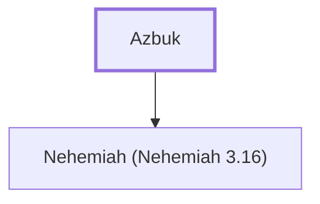

# Azbuk

Father of Nehemiah, who repaired part of Jerusalem's wall

**Original-language names:** עַזְבּוּק (H5802)

## When

- **Placed around:** [[connections/timeline/5th century BC|445 BC]] *(Ussher: the median date of the passages naming them)*

## Family

- **Children:** [[connections/people/Nehemiah (Nehemiah 3.16)|Nehemiah (Nehemiah 3.16)]]

**Family group:** [[connections/genealogy/Family of Azbuk|Family of Azbuk]], generation 1

## Appears in

[[connections/chapters/16-nehemiah/Nehemiah 3|Nehemiah 3]]

## Appears in the same verse as

[[connections/people/David|David]] · [[connections/people/Nehemiah (Nehemiah 3.16)|Nehemiah (Nehemiah 3.16)]] · [[connections/places/Beth-zur|Beth-zur]]
