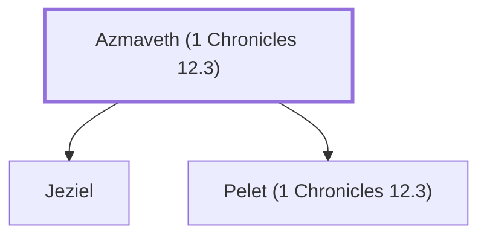

# Azmaveth (1 Chronicles 12.3)

Benjamite warrior who joined David at Ziklag

**Original-language names:** עַזְמָ֫וֶת (H5820)

## Family

- **Children:** [[connections/people/Jeziel|Jeziel]], [[connections/people/Pelet (1 Chronicles 12.3)|Pelet (1 Chronicles 12.3)]]

**Family group:** [[connections/genealogy/Family of Azmaveth (1 Chronicles 12.3)|Family of Azmaveth (1 Chronicles 12.3)]], generation 1

## Appears in

[[connections/chapters/13-1-chronicles/1 Chronicles 12|1 Chronicles 12]]

## Appears in the same verse as

[[connections/people/Ahiezer (1 Chronicles 12.3)|Ahiezer (1 Chronicles 12.3)]] · [[connections/people/Beracah|Beracah]] · [[connections/people/Jehu (1 Chronicles 12.3)|Jehu (1 Chronicles 12.3)]] · [[connections/people/Jeziel|Jeziel]] · [[connections/people/Joash (1 Chronicles 12.3)|Joash (1 Chronicles 12.3)]] · [[connections/people/Pelet (1 Chronicles 12.3)|Pelet (1 Chronicles 12.3)]] · [[connections/people/Shemaah|Shemaah]]
