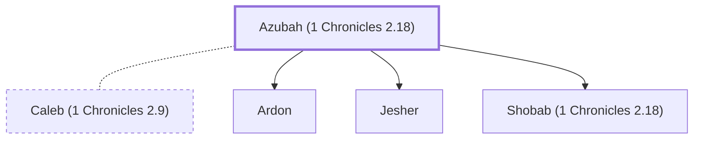

# Azubah (1 Chronicles 2.18)

Wife of Caleb and mother of Jesher, Shobab, and Ardon.

**Original-language names:** עֲזוּבָה (H5806)

## When

- **Placed around:** [[connections/timeline/15th century BC|1470 BC]] *(Ussher: the median date of the passages naming them)*

## Family

- **Spouses:** [[connections/people/Caleb (1 Chronicles 2.9)|Caleb (1 Chronicles 2.9)]]
- **Children:** [[connections/people/Ardon|Ardon (uncertain)]], [[connections/people/Jesher|Jesher (uncertain)]], [[connections/people/Shobab (1 Chronicles 2.18)|Shobab (1 Chronicles 2.18) (uncertain)]]
- **Tribe or nation:** Tribe of Judah(?)

**Family group:** [[connections/genealogy/Family of Adam|Family of Adam]], generation 29

## Appears in

[[connections/chapters/13-1-chronicles/1 Chronicles 2|1 Chronicles 2 (2)]]

## Appears in the same verse as

[[connections/people/Caleb (1 Chronicles 2.9)|Caleb (1 Chronicles 2.9) (2)]] · [[connections/people/Ardon|Ardon]] · [[connections/people/Ephrathah|Ephrathah]] · [[connections/people/Hezron (Genesis 46.12)|Hezron (Genesis 46.12)]] · [[connections/people/Hur (Exodus 17.10)|Hur (Exodus 17.10)]] · [[connections/people/Jerioth|Jerioth]] · [[connections/people/Jesher|Jesher]] · [[connections/people/Shobab (1 Chronicles 2.18)|Shobab (1 Chronicles 2.18)]]
