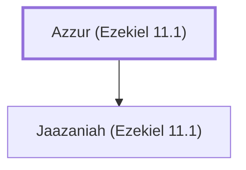

# Azzur (Ezekiel 11.1)

Father of the wicked prince Jaazaniah.

**Original-language names:** עַזּוּר (H5809)

## When

- **Placed around:** [[connections/timeline/6th century BC|594 BC]] *(Ussher: the median date of the passages naming them)*

## Family

- **Children:** [[connections/people/Jaazaniah (Ezekiel 11.1)|Jaazaniah (Ezekiel 11.1)]]

**Family group:** [[connections/genealogy/Family of Azzur (Ezekiel 11.1)|Family of Azzur (Ezekiel 11.1)]], generation 1

## Appears in

[[connections/chapters/26-ezekiel/Ezekiel 11|Ezekiel 11]]

## Appears in the same verse as

[[connections/people/Benaiah (Ezekiel 11.1)|Benaiah (Ezekiel 11.1)]] · [[connections/people/Jaazaniah (Ezekiel 11.1)|Jaazaniah (Ezekiel 11.1)]] · [[connections/people/Pelatiah (Ezekiel 11.1)|Pelatiah (Ezekiel 11.1)]]
