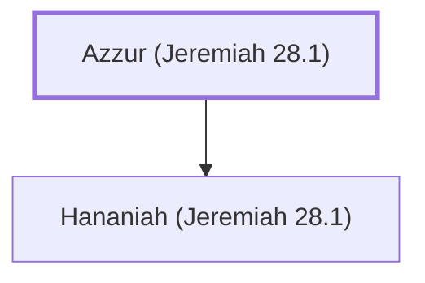

# Azzur (Jeremiah 28.1)

Father of the false prophet Hananiah.

**Original-language names:** עַזּוּר (H5809)

## When

- **Placed around:** [[connections/timeline/6th century BC|595 BC]] *(Ussher: the median date of the passages naming them)*

## Family

- **Children:** [[connections/people/Hananiah (Jeremiah 28.1)|Hananiah (Jeremiah 28.1)]]

**Family group:** [[connections/genealogy/Family of Azzur (Jeremiah 28.1)|Family of Azzur (Jeremiah 28.1)]], generation 1

## Appears in

[[connections/chapters/24-jeremiah/Jeremiah 28|Jeremiah 28]]

## Appears in the same verse as

[[connections/people/Hananiah (Jeremiah 28.1)|Hananiah (Jeremiah 28.1)]] · [[connections/people/Judah (Genesis 29.35)|Judah (Genesis 29.35)]] · [[connections/people/Zedekiah (2 Kings 24.17)|Zedekiah (2 Kings 24.17)]] · [[connections/places/Gibeon|Gibeon]]
