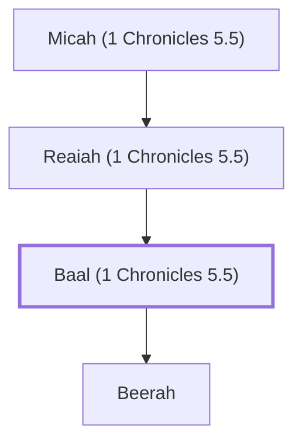

# Baal (1 Chronicles 5.5)

A descendant of Reuben.

**Original-language names:** בַּ֫עַל (H1168b)

## When

- **Placed around:** [[connections/timeline/18th century BC|1710 BC]] *(Ussher: the median date of the passages naming them)*

## Family

- **Father:** [[connections/people/Reaiah (1 Chronicles 5.5)|Reaiah (1 Chronicles 5.5)]]
- **Children:** [[connections/people/Beerah|Beerah]]
- **Tribe or nation:** Tribe of Reuben

**Line of descent** (7 generations, father to son): [[connections/people/Joel (1 Chronicles 5.4)|Joel (1 Chronicles 5.4)]] → [[connections/people/Shemaiah (1 Chronicles 5.4)|Shemaiah (1 Chronicles 5.4)]] → [[connections/people/Gog|Gog]] → [[connections/people/Shimei (1 Chronicles 5.4)|Shimei (1 Chronicles 5.4)]] → [[connections/people/Micah (1 Chronicles 5.5)|Micah (1 Chronicles 5.5)]] → [[connections/people/Reaiah (1 Chronicles 5.5)|Reaiah (1 Chronicles 5.5)]] → **Baal (1 Chronicles 5.5)**

**Family group:** [[connections/genealogy/Family of Joel (1 Chronicles 5.4)|Family of Joel (1 Chronicles 5.4)]], generation 7

## Appears in

[[connections/chapters/13-1-chronicles/1 Chronicles 5|1 Chronicles 5]]

## Appears in the same verse as

[[connections/people/Micah (1 Chronicles 5.5)|Micah (1 Chronicles 5.5)]] · [[connections/people/Reaiah (1 Chronicles 5.5)|Reaiah (1 Chronicles 5.5)]]
