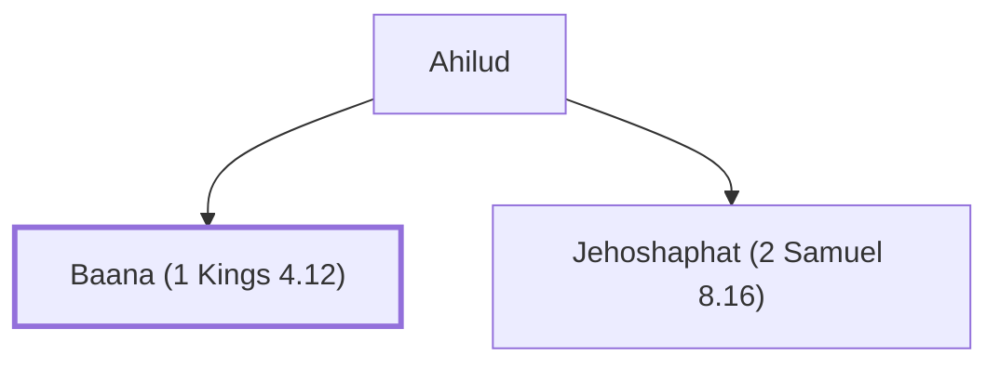

# Baana (1 Kings 4.12)

One of Solomon's twelve district governors.

**Original-language names:** בַּעֲנָא (H1195)

## When

- **Placed around:** [[connections/timeline/11th century BC|1014 BC]] *(Ussher: the median date of the passages naming them)*

## Family

- **Father:** [[connections/people/Ahilud|Ahilud]]
- **Brothers and sisters:** [[connections/people/Jehoshaphat (2 Samuel 8.16)|Jehoshaphat (2 Samuel 8.16)]]

**Family group:** [[connections/genealogy/Family of Ahilud|Family of Ahilud]], generation 2

## Appears in

[[connections/chapters/11-1-kings/1 Kings 4|1 Kings 4]]

## Appears in the same verse as

[[connections/people/Ahilud|Ahilud]] · [[connections/places/Abel-meholah|Abel-meholah]] · [[connections/places/Beth-shean|Beth-shean]] · [[connections/places/Jezreel (Joshua 19.18)|Jezreel (Joshua 19.18)]] · [[connections/places/Jokneam|Jokneam]] · [[connections/places/Megiddo|Megiddo]] · [[connections/places/Taanach|Taanach]] · [[connections/places/Zarethan|Zarethan]]
