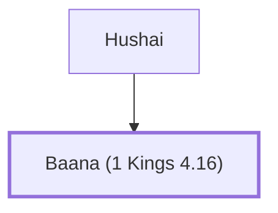

# Baana (1 Kings 4.16)

One of Solomon's twelve district governors.

**Original-language names:** בַּעֲנָא (H1195)

## When

- **Placed around:** [[connections/timeline/11th century BC|1014 BC]] *(Ussher: the median date of the passages naming them)*

## Family

- **Father:** [[connections/people/Hushai|Hushai]]

**Family group:** [[connections/genealogy/Family of Hushai|Family of Hushai]], generation 2

## Appears in

[[connections/chapters/11-1-kings/1 Kings 4|1 Kings 4]]

## Appears in the same verse as

[[connections/people/Asher|Asher]] · [[connections/people/Hushai|Hushai]] · [[connections/places/Baalath-beer|Baalath-beer]]
