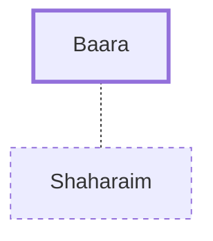

# Baara

A wife of Shaharaim, a Benjamite.

**Original-language names:** בַּעֲרָא (H1199)

## Family

- **Spouses:** [[connections/people/Shaharaim|Shaharaim]]
- **Tribe or nation:** Tribe of Benjamin

## Appears in

[[connections/chapters/13-1-chronicles/1 Chronicles 8|1 Chronicles 8]]

## Appears in the same verse as

[[connections/people/Hushim (1 Chronicles 8.8)|Hushim (1 Chronicles 8.8)]] · [[connections/people/Shaharaim|Shaharaim]] · [[connections/places/Moab|Moab]]
