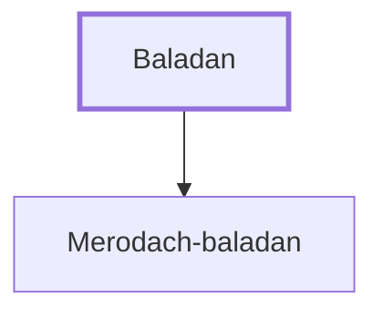

# Baladan

Father of Babylonian king Merodach-baladan (or 'Berodach-baladan').

**Original-language names:** בַּלְאֲדָן (H1081)

## When

- **Placed around:** [[connections/timeline/8th century BC|712 BC]] *(Ussher: the median date of the passages naming them)*

## Family

- **Children:** [[connections/people/Merodach-baladan|Merodach-baladan]]

**Family group:** [[connections/genealogy/Family of Baladan|Family of Baladan]], generation 1

## Appears in

[[connections/chapters/12-2-kings/2 Kings 20|2 Kings 20]] · [[connections/chapters/23-isaiah/Isaiah 39|Isaiah 39]]

## Appears in the same verse as

[[connections/people/Hezekiah (2 Kings 16.20)|Hezekiah (2 Kings 16.20) (2)]] · [[connections/people/Merodach-baladan|Merodach-baladan (2)]] · [[connections/places/Babylon|Babylon (2)]]
