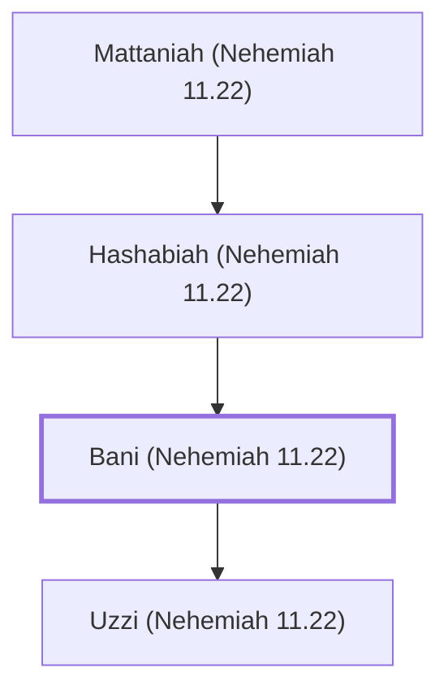

# Bani (Nehemiah 11.22)

A Levite overseer in Jerusalem during Nehemiah's time.

**Original-language names:** בָּנִי (H1137)

## When

- **Placed around:** [[connections/timeline/5th century BC|445 BC]] *(Ussher: the median date of the passages naming them)*

## Family

- **Father:** [[connections/people/Hashabiah (Nehemiah 11.22)|Hashabiah (Nehemiah 11.22)]]
- **Children:** [[connections/people/Uzzi (Nehemiah 11.22)|Uzzi (Nehemiah 11.22)]]

**Line of descent** (4 generations, father to son): [[connections/people/Mica (Nehemiah 11.22)|Mica (Nehemiah 11.22)]] → [[connections/people/Mattaniah (Nehemiah 11.22)|Mattaniah (Nehemiah 11.22)]] → [[connections/people/Hashabiah (Nehemiah 11.22)|Hashabiah (Nehemiah 11.22)]] → **Bani (Nehemiah 11.22)**

**Family group:** [[connections/genealogy/Family of Mica (Nehemiah 11.22)|Family of Mica (Nehemiah 11.22)]], generation 4

## Appears in

[[connections/chapters/16-nehemiah/Nehemiah 11|Nehemiah 11]]

## Appears in the same verse as

[[connections/people/Asaph (1 Chronicles 6.24)|Asaph (1 Chronicles 6.24)]] · [[connections/people/Hashabiah (Nehemiah 11.22)|Hashabiah (Nehemiah 11.22)]] · [[connections/people/Mattaniah (Nehemiah 11.22)|Mattaniah (Nehemiah 11.22)]] · [[connections/people/Mica (Nehemiah 11.22)|Mica (Nehemiah 11.22)]] · [[connections/people/Uzzi (Nehemiah 11.22)|Uzzi (Nehemiah 11.22)]] · [[connections/places/Jerusalem|Jerusalem]]
