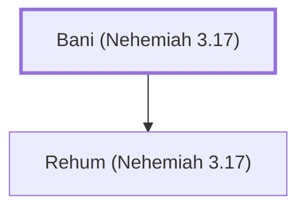

# Bani (Nehemiah 3.17)

A Levite who helped repair the wall of Jerusalem.

**Original-language names:** בָּנִי (H1137)

## When

- **Placed around:** [[connections/timeline/5th century BC|445 BC]] *(Ussher: the median date of the passages naming them)*

## Family

- **Children:** [[connections/people/Rehum (Nehemiah 3.17)|Rehum (Nehemiah 3.17)]]

**Family group:** [[connections/genealogy/Family of Bani (Nehemiah 3.17)|Family of Bani (Nehemiah 3.17)]], generation 1

## Appears in

[[connections/chapters/16-nehemiah/Nehemiah 3|Nehemiah 3]]

## Appears in the same verse as

[[connections/people/Hashabiah (Nehemiah 3.17)|Hashabiah (Nehemiah 3.17)]] · [[connections/people/Rehum (Nehemiah 3.17)|Rehum (Nehemiah 3.17)]] · [[connections/places/Keilah|Keilah]]
