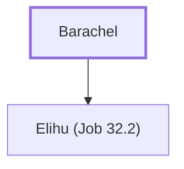

# Barachel

The father of Elihu, one of Job's friends.

**Original-language names:** בָּרַכְאֵל (H1292)

## When

- **Placed around:** [[connections/timeline/16th century BC|1520 BC]] *(Ussher: the median date of the passages naming them)*

## Family

- **Children:** [[connections/people/Elihu (Job 32.2)|Elihu (Job 32.2)]]

**Family group:** [[connections/genealogy/Family of Barachel|Family of Barachel]], generation 1

## Appears in

[[connections/chapters/18-job/Job 32|Job 32 (2)]]

## Appears in the same verse as

[[connections/people/Elihu (Job 32.2)|Elihu (Job 32.2) (2)]] · [[connections/people/Job|Job]] · [[connections/people/Ram (Job 32.2)|Ram (Job 32.2)]]
