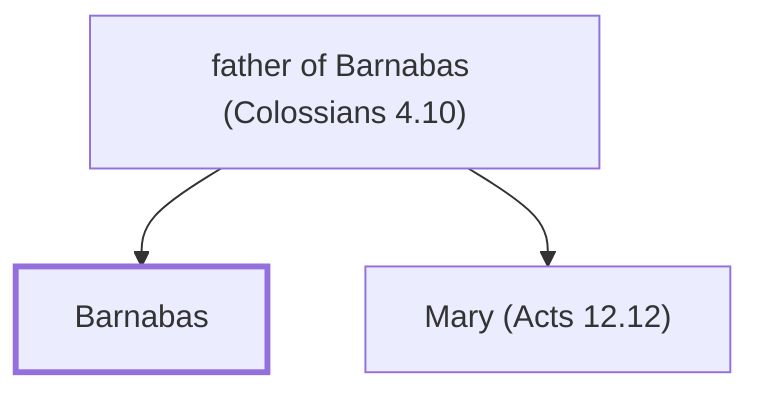

# Barnabas

A Levite from Cyprus who accompanied Paul on missionary journeys.

**Also called:** Joseph, Joses

**Original-language names:** Βαρνάβας (G0921) · Ἰωσήφ (G2501) · Ἰωσῆς (G2500)

## When

- **Placed around:** [[connections/timeline/1st century AD|AD 46]] *(Ussher: the median date of the passages naming them)*

## Family

- **Father:** [[connections/people/father of Barnabas (Colossians 4.10)|father of Barnabas (Colossians 4.10)]]
- **Brothers and sisters:** [[connections/people/Mary (Acts 12.12)|Mary (Acts 12.12)]]
- **Tribe or nation:** Tribe of Levi

**Family group:** [[connections/genealogy/Family of father of Barnabas (Colossians 4.10)|Family of father of Barnabas (Colossians 4.10)]], generation 2

## Events

- [[connections/timeline/1st century AD|AD 30]] · [[connections/events/Believers share all things|Believers share all things]]
- [[connections/timeline/1st century AD|AD 38]] · [[connections/events/Saul proclaims Jesus|Saul proclaims Jesus]]
- [[connections/timeline/1st century AD|AD 40]] · [[connections/events/Disciples first called Christians|Disciples first called Christians]]
- [[connections/timeline/1st century AD|AD 45]] · [[connections/events/First missionary journey begins|First missionary journey begins]]
- [[connections/timeline/1st century AD|AD 45]] · [[connections/events/First Missionary Journey|First Missionary Journey]]
- [[connections/timeline/1st century AD|AD 45]] · [[connections/events/Barnabas and Saul go to Cyprus|Barnabas and Saul go to Cyprus]]
- [[connections/timeline/1st century AD|AD 45]] · [[connections/events/Mission to Antioch in Pisidia|Mission to Antioch in Pisidia]]
- [[connections/timeline/1st century AD|AD 46]] · [[connections/events/Mission to Iconium|Mission to Iconium]]
- [[connections/timeline/1st century AD|AD 46]] · [[connections/events/Mission to Lystra and Derbe|Mission to Lystra and Derbe]]
- [[connections/timeline/1st century AD|AD 46]] · [[connections/events/Return to Antioch in Syria|Return to Antioch in Syria]]
- [[connections/timeline/1st century AD|AD 46]] · [[connections/events/Jerusalem Council|Jerusalem Council]]
- [[connections/timeline/1st century AD|AD 46]] · [[connections/events/Second Missionary Journey|Second Missionary Journey]]
- [[connections/timeline/1st century AD|AD 47]] · [[connections/events/Paul and Barnabas part ways|Paul and Barnabas part ways]]

## Appears in

[[connections/chapters/44-acts/Acts 4|Acts 4]] · [[connections/chapters/44-acts/Acts 9|Acts 9]] · [[connections/chapters/44-acts/Acts 11|Acts 11 (3)]] · [[connections/chapters/44-acts/Acts 12|Acts 12]] · [[connections/chapters/44-acts/Acts 13|Acts 13 (6)]] · [[connections/chapters/44-acts/Acts 14|Acts 14 (3)]] · [[connections/chapters/44-acts/Acts 15|Acts 15 (8)]] · [[connections/chapters/46-1-corinthians/1 Corinthians 9|1 Corinthians 9]] · [[connections/chapters/48-galatians/Galatians 2|Galatians 2 (3)]] · [[connections/chapters/51-colossians/Colossians 4|Colossians 4]]

## Appears in the same verse as

[[connections/people/Paul|Paul (17)]] · [[connections/people/Mark|Mark (4)]] · [[connections/places/Antioch (Acts 11.19)|Antioch (Acts 11.19) (4)]] · [[connections/places/Jerusalem|Jerusalem (4)]] · [[connections/places/Cyprus|Cyprus (2)]] · [[connections/people/Aristarchus|Aristarchus]] · [[connections/people/Herod (Matthew 14.1)|Herod (Matthew 14.1)]] · [[connections/people/James (Matthew 13.55)|James (Matthew 13.55)]] · [[connections/people/Jesus|Jesus]] · [[connections/people/John (Matthew 4.21)|John (Matthew 4.21)]] · [[connections/people/Judas (Acts 15.22)|Judas (Acts 15.22)]] · [[connections/people/Lucius|Lucius]] · [[connections/people/Manaen|Manaen]] · [[connections/people/Peter|Peter]] · [[connections/people/Sergius Paulus|Sergius Paulus]] · [[connections/people/Silas|Silas]] · [[connections/people/Simeon (Acts 13.1)|Simeon (Acts 13.1)]] · [[connections/people/Titus|Titus]] · [[connections/places/Cyrene|Cyrene]] · [[connections/places/Damascus|Damascus]] · [[connections/places/Derbe|Derbe]] · [[connections/places/Tarsus|Tarsus]]
