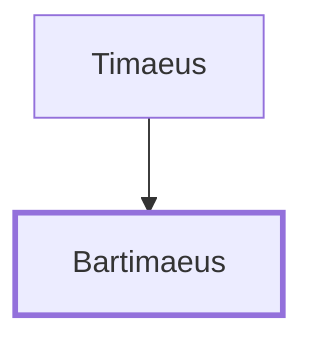

# Bartimaeus

A blind beggar healed by Jesus near Jericho.

**Original-language names:** Βαρτιμαῖος (G0924)

## When

- **Placed around:** [[connections/timeline/1st century AD|AD 29]] *(Ussher: the median date of the passages naming them)*

## Family

- **Father:** [[connections/people/Timaeus|Timaeus]]

**Family group:** [[connections/genealogy/Family of Timaeus|Family of Timaeus]], generation 2

## Events

- [[connections/timeline/1st century AD|AD 30]] · [[connections/events/Healing Blind Bartimaeus|Healing Blind Bartimaeus]]

## Appears in

[[connections/chapters/41-mark/Mark 10|Mark 10]]

## Appears in the same verse as

[[connections/people/Timaeus|Timaeus]] · [[connections/places/Jericho|Jericho]]
