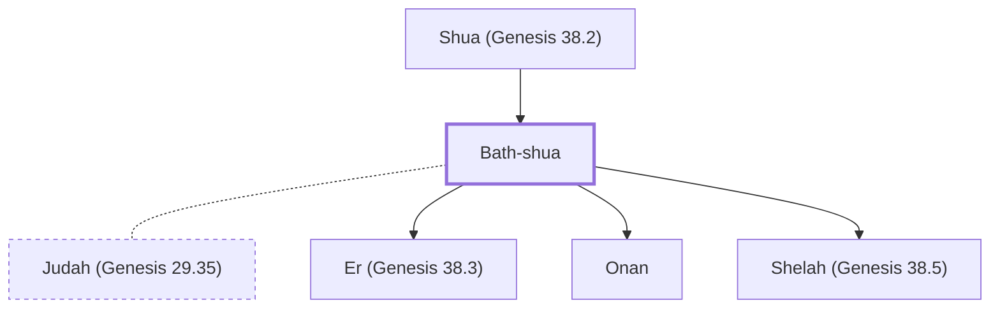

# Bath-shua

Judah's Canaanite wife; mother of Er, Onan, and Shelah.

**Original-language names:** בַּת+H7770«H7770=שׁוּעַ (H1323)

## When

- **Placed around:** [[connections/timeline/18th century BC|1739 BC]] *(Ussher: the median date of the passages naming them)*

## Family

- **Father:** [[connections/people/Shua (Genesis 38.2)|Shua (Genesis 38.2)]]
- **Spouses:** [[connections/people/Judah (Genesis 29.35)|Judah (Genesis 29.35)]]
- **Children:** [[connections/people/Er (Genesis 38.3)|Er (Genesis 38.3)]], [[connections/people/Onan|Onan]], [[connections/people/Shelah (Genesis 38.5)|Shelah (Genesis 38.5)]]

**Family group:** [[connections/genealogy/Family of Adam|Family of Adam]], generation 2

## Appears in

[[connections/chapters/01-genesis/Genesis 38|Genesis 38]] · [[connections/chapters/13-1-chronicles/1 Chronicles 2|1 Chronicles 2]]

## Appears in the same verse as

[[connections/people/Judah (Genesis 29.35)|Judah (Genesis 29.35) (2)]] · [[connections/people/Shua (Genesis 38.2)|Shua (Genesis 38.2) (2)]] · [[connections/people/Er (Genesis 38.3)|Er (Genesis 38.3)]] · [[connections/people/Onan|Onan]] · [[connections/people/Shelah (Genesis 38.5)|Shelah (Genesis 38.5)]]
