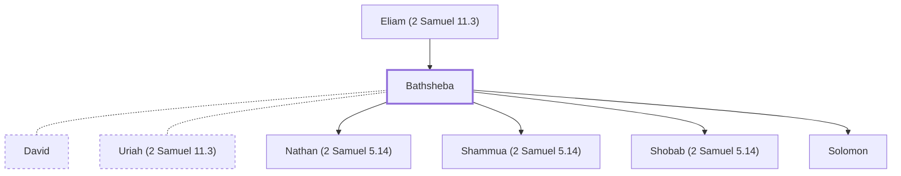

# Bathsheba

Wife of Uriah, later married David and bore Solomon.

**Original-language names:** בַּת־שֶׁ֫בַע (H1339) · בַּת־שׁוּעַ (H1340)

## When

- **Placed around:** [[connections/timeline/11th century BC|1015 BC]] *(Ussher: the median date of the passages naming them)*

## Family

- **Father:** [[connections/people/Eliam (2 Samuel 11.3)|Eliam (2 Samuel 11.3)]]
- **Spouses:** [[connections/people/David|David]], [[connections/people/Uriah (2 Samuel 11.3)|Uriah (2 Samuel 11.3)]]
- **Children:** [[connections/people/Nathan (2 Samuel 5.14)|Nathan (2 Samuel 5.14)]], [[connections/people/Shammua (2 Samuel 5.14)|Shammua (2 Samuel 5.14)]], [[connections/people/Shobab (2 Samuel 5.14)|Shobab (2 Samuel 5.14)]], [[connections/people/Solomon|Solomon]]

**Family group:** [[connections/genealogy/Family of Adam|Family of Adam]], generation 2

## Appears in

[[connections/chapters/10-2-samuel/2 Samuel 11|2 Samuel 11]] · [[connections/chapters/10-2-samuel/2 Samuel 12|2 Samuel 12]] · [[connections/chapters/11-1-kings/1 Kings 1|1 Kings 1 (5)]] · [[connections/chapters/11-1-kings/1 Kings 2|1 Kings 2 (3)]] · [[connections/chapters/13-1-chronicles/1 Chronicles 3|1 Chronicles 3]] · [[connections/chapters/19-psalms/Psalms 51|Psalms 51]]

## Appears in the same verse as

[[connections/people/David|David (6)]] · [[connections/people/Solomon|Solomon (5)]] · [[connections/people/Adonijah (2 Samuel 3.4)|Adonijah (2 Samuel 3.4) (3)]] · [[connections/people/Eliam (2 Samuel 11.3)|Eliam (2 Samuel 11.3) (2)]] · [[connections/people/Haggith|Haggith (2)]] · [[connections/people/Nathan (2 Samuel 7.2)|Nathan (2 Samuel 7.2) (2)]] · [[connections/people/Abishag|Abishag]] · [[connections/people/Nathan (2 Samuel 5.14)|Nathan (2 Samuel 5.14)]] · [[connections/people/Shammua (2 Samuel 5.14)|Shammua (2 Samuel 5.14)]] · [[connections/people/Shobab (2 Samuel 5.14)|Shobab (2 Samuel 5.14)]] · [[connections/people/Uriah (2 Samuel 11.3)|Uriah (2 Samuel 11.3)]] · [[connections/places/Jerusalem|Jerusalem]]
