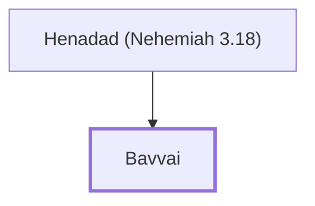

# Bavvai

A leader who helped repair Jerusalem's wall

**Original-language names:** בַּוַּי (H0942)

## When

- **Placed around:** [[connections/timeline/5th century BC|445 BC]] *(Ussher: the median date of the passages naming them)*

## Family

- **Father:** [[connections/people/Henadad (Nehemiah 3.18)|Henadad (Nehemiah 3.18)]]

**Family group:** [[connections/genealogy/Family of Henadad (Nehemiah 3.18)|Family of Henadad (Nehemiah 3.18)]], generation 2

## Appears in

[[connections/chapters/16-nehemiah/Nehemiah 3|Nehemiah 3]]

## Appears in the same verse as

[[connections/people/Henadad (Nehemiah 3.18)|Henadad (Nehemiah 3.18)]] · [[connections/places/Keilah|Keilah]]
