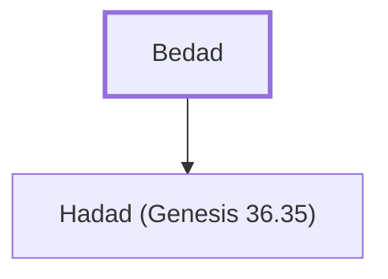

# Bedad

Father of Hadad, an Edomite king.

**Original-language names:** בְּדַד (H0911)

## When

- **Placed around:** [[connections/timeline/18th century BC|1785 BC]] *(Ussher: the median date of the passages naming them)*

## Family

- **Children:** [[connections/people/Hadad (Genesis 36.35)|Hadad (Genesis 36.35)]]
- **Tribe or nation:** Edom

**Family group:** [[connections/genealogy/Family of Bedad|Family of Bedad]], generation 1

## Appears in

[[connections/chapters/01-genesis/Genesis 36|Genesis 36]] · [[connections/chapters/13-1-chronicles/1 Chronicles 1|1 Chronicles 1]]

## Appears in the same verse as

[[connections/people/Hadad (Genesis 36.35)|Hadad (Genesis 36.35) (2)]] · [[connections/people/Husham|Husham (2)]] · [[connections/places/Avith|Avith (2)]] · [[connections/places/Midian|Midian (2)]] · [[connections/places/Moab|Moab (2)]]
