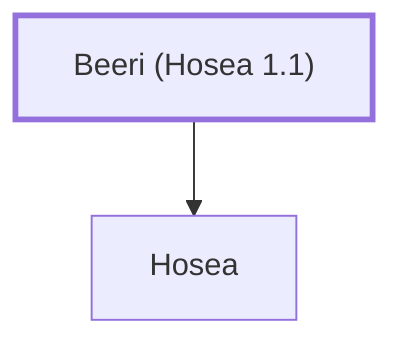

# Beeri (Hosea 1.1)

Father of the prophet Hosea.

**Original-language names:** בְּאֵרִי (H0882)

## When

- **Placed around:** [[connections/timeline/8th century BC|785 BC]] *(Ussher: the median date of the passages naming them)*

## Family

- **Children:** [[connections/people/Hosea|Hosea]]

**Family group:** [[connections/genealogy/Family of Beeri (Hosea 1.1)|Family of Beeri (Hosea 1.1)]], generation 1

## Appears in

[[connections/chapters/28-hosea/Hosea 1|Hosea 1]]

## Appears in the same verse as

[[connections/people/Ahaz (2 Kings 15.38)|Ahaz (2 Kings 15.38)]] · [[connections/people/Hezekiah (2 Kings 16.20)|Hezekiah (2 Kings 16.20)]] · [[connections/people/Hosea|Hosea]] · [[connections/people/Israel|Israel]] · [[connections/people/Jeroboam (2 Kings 13.13)|Jeroboam (2 Kings 13.13)]] · [[connections/people/Joash (2 Kings 13.9)|Joash (2 Kings 13.9)]] · [[connections/people/Jotham (2 Kings 15.5)|Jotham (2 Kings 15.5)]] · [[connections/people/Judah (Genesis 29.35)|Judah (Genesis 29.35)]] · [[connections/people/Uzziah (2 Kings 14.21)|Uzziah (2 Kings 14.21)]]
