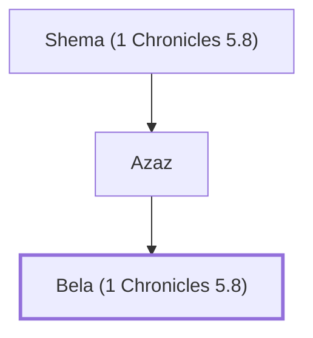

# Bela (1 Chronicles 5.8)

A Reubenite, son of Azaz.

**Original-language names:** בֶּ֫לַע (H1106a)

## When

- **Placed around:** [[connections/timeline/18th century BC|1710 BC]] *(Ussher: the median date of the passages naming them)*

## Family

- **Father:** [[connections/people/Azaz|Azaz]]
- **Tribe or nation:** Tribe of Reuben

**Line of descent** (4 generations, father to son): [[connections/people/Joel (1 Chronicles 5.8)|Joel (1 Chronicles 5.8)]] → [[connections/people/Shema (1 Chronicles 5.8)|Shema (1 Chronicles 5.8)]] → [[connections/people/Azaz|Azaz]] → **Bela (1 Chronicles 5.8)**

**Family group:** [[connections/genealogy/Family of Joel (1 Chronicles 5.8)|Family of Joel (1 Chronicles 5.8)]], generation 4

## Appears in

[[connections/chapters/13-1-chronicles/1 Chronicles 5|1 Chronicles 5]]

## Appears in the same verse as

[[connections/people/Azaz|Azaz]] · [[connections/people/Joel (1 Chronicles 5.8)|Joel (1 Chronicles 5.8)]] · [[connections/people/Shema (1 Chronicles 5.8)|Shema (1 Chronicles 5.8)]] · [[connections/places/Aroer (Numbers 32.34)|Aroer (Numbers 32.34)]] · [[connections/places/Baal-meon|Baal-meon]] · [[connections/places/Nebo (Numbers 32.3)|Nebo (Numbers 32.3)]]
