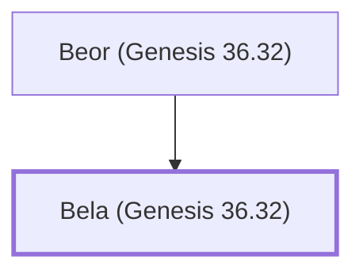

# Bela (Genesis 36.32)

Son of Beor, the first king of Edom.

**Original-language names:** בֶּ֫לַע (H1106a)

## When

- **Placed around:** [[connections/timeline/19th century BC|1853 BC]] *(Ussher: the median date of the passages naming them)*

## Family

- **Father:** [[connections/people/Beor (Genesis 36.32)|Beor (Genesis 36.32)]]
- **Tribe or nation:** Edom

**Family group:** [[connections/genealogy/Family of Beor (Genesis 36.32)|Family of Beor (Genesis 36.32)]], generation 2

## Appears in

[[connections/chapters/01-genesis/Genesis 36|Genesis 36 (2)]] · [[connections/chapters/13-1-chronicles/1 Chronicles 1|1 Chronicles 1 (2)]]

## Appears in the same verse as

[[connections/people/Beor (Genesis 36.32)|Beor (Genesis 36.32) (2)]] · [[connections/people/Jobab (Genesis 36.33)|Jobab (Genesis 36.33) (2)]] · [[connections/people/Zerah (Genesis 36.33)|Zerah (Genesis 36.33) (2)]] · [[connections/places/Bozrah|Bozrah (2)]] · [[connections/places/Dinhabah|Dinhabah (2)]] · [[connections/places/Edom|Edom (2)]] · [[connections/people/Israel|Israel]]
