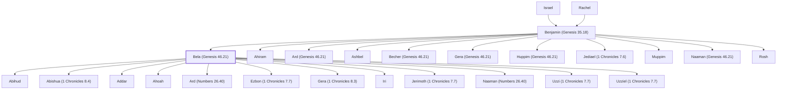

# Bela (Genesis 46.21)

Son of Benjamin, head of the Belaite clan

**Original-language names:** בֶּ֫לַע (H1106a)

## When

- **Placed around:** [[connections/timeline/15th century BC|1452 BC]] *(Ussher: the median date of the passages naming them)*

## Family

- **Father:** [[connections/people/Benjamin (Genesis 35.18)|Benjamin (Genesis 35.18)]]
- **Brothers and sisters:** [[connections/people/Ahiram|Ahiram]], [[connections/people/Ard (Genesis 46.21)|Ard (Genesis 46.21)]], [[connections/people/Ashbel|Ashbel]], [[connections/people/Becher (Genesis 46.21)|Becher (Genesis 46.21)]], [[connections/people/Gera (Genesis 46.21)|Gera (Genesis 46.21)]], [[connections/people/Huppim (Genesis 46.21)|Huppim (Genesis 46.21)]], [[connections/people/Jediael (1 Chronicles 7.6)|Jediael (1 Chronicles 7.6)]], [[connections/people/Muppim|Muppim]], [[connections/people/Naaman (Genesis 46.21)|Naaman (Genesis 46.21)]], [[connections/people/Rosh|Rosh]]
- **Children:** [[connections/people/Abihud|Abihud]], [[connections/people/Abishua (1 Chronicles 8.4)|Abishua (1 Chronicles 8.4)]], [[connections/people/Addar|Addar]], [[connections/people/Ahoah|Ahoah]], [[connections/people/Ard (Numbers 26.40)|Ard (Numbers 26.40)]], [[connections/people/Ezbon (1 Chronicles 7.7)|Ezbon (1 Chronicles 7.7)]], [[connections/people/Gera (1 Chronicles 8.3)|Gera (1 Chronicles 8.3)]], [[connections/people/Iri|Iri]], [[connections/people/Jerimoth (1 Chronicles 7.7)|Jerimoth (1 Chronicles 7.7)]], [[connections/people/Naaman (Numbers 26.40)|Naaman (Numbers 26.40)]], [[connections/people/Uzzi (1 Chronicles 7.7)|Uzzi (1 Chronicles 7.7)]], [[connections/people/Uzziel (1 Chronicles 7.7)|Uzziel (1 Chronicles 7.7)]]
- **Tribe or nation:** Tribe of Benjamin

**Line of descent** (25 generations, father to son): [[connections/people/Adam|Adam]] → [[connections/people/Seth|Seth]] → [[connections/people/Enosh|Enosh]] → [[connections/people/Kenan|Kenan]] → [[connections/people/Mahalalel (Genesis 5.12)|Mahalalel (Genesis 5.12)]] → [[connections/people/Jared|Jared]] → [[connections/people/Enoch (Genesis 5.18)|Enoch (Genesis 5.18)]] → [[connections/people/Methuselah|Methuselah]] → [[connections/people/Lamech (Genesis 5.25)|Lamech (Genesis 5.25)]] → [[connections/people/Noah (Genesis 5.29)|Noah (Genesis 5.29)]] → [[connections/people/Shem|Shem]] → [[connections/people/Arpachshad|Arpachshad]] → [[connections/people/Cainan|Cainan]] → [[connections/people/Shelah (Genesis 10.24)|Shelah (Genesis 10.24)]] → [[connections/people/Eber (Genesis 10.21)|Eber (Genesis 10.21)]] → [[connections/people/Peleg|Peleg]] → [[connections/people/Reu|Reu]] → [[connections/people/Serug|Serug]] → [[connections/people/Nahor (Genesis 11.22)|Nahor (Genesis 11.22)]] → [[connections/people/Terah|Terah]] → [[connections/people/Abraham|Abraham]] → [[connections/people/Isaac|Isaac]] → [[connections/people/Israel|Israel]] → [[connections/people/Benjamin (Genesis 35.18)|Benjamin (Genesis 35.18)]] → **Bela (Genesis 46.21)**

**Family group:** [[connections/genealogy/Family of Adam|Family of Adam]], generation 25

## Appears in

[[connections/chapters/01-genesis/Genesis 46|Genesis 46]] · [[connections/chapters/04-numbers/Numbers 26|Numbers 26 (2)]] · [[connections/chapters/13-1-chronicles/1 Chronicles 7|1 Chronicles 7 (2)]] · [[connections/chapters/13-1-chronicles/1 Chronicles 8|1 Chronicles 8 (2)]]

## Appears in the same verse as

[[connections/people/Benjamin (Genesis 35.18)|Benjamin (Genesis 35.18) (4)]] · [[connections/people/Ahiram|Ahiram (3)]] · [[connections/people/Ashbel|Ashbel (3)]] · [[connections/people/Becher (Genesis 46.21)|Becher (Genesis 46.21) (2)]] · [[connections/people/Abihud|Abihud]] · [[connections/people/Addar|Addar]] · [[connections/people/Ard (Genesis 46.21)|Ard (Genesis 46.21)]] · [[connections/people/Ard (Numbers 26.40)|Ard (Numbers 26.40)]] · [[connections/people/Ezbon (1 Chronicles 7.7)|Ezbon (1 Chronicles 7.7)]] · [[connections/people/Gera (1 Chronicles 8.3)|Gera (1 Chronicles 8.3)]] · [[connections/people/Gera (Genesis 46.21)|Gera (Genesis 46.21)]] · [[connections/people/Huppim (Genesis 46.21)|Huppim (Genesis 46.21)]] · [[connections/people/Iri|Iri]] · [[connections/people/Jediael (1 Chronicles 7.6)|Jediael (1 Chronicles 7.6)]] · [[connections/people/Jerimoth (1 Chronicles 7.7)|Jerimoth (1 Chronicles 7.7)]] · [[connections/people/Muppim|Muppim]] · [[connections/people/Naaman (Genesis 46.21)|Naaman (Genesis 46.21)]] · [[connections/people/Naaman (Numbers 26.40)|Naaman (Numbers 26.40)]] · [[connections/people/Rosh|Rosh]] · [[connections/people/Uzzi (1 Chronicles 7.7)|Uzzi (1 Chronicles 7.7)]] · [[connections/people/Uzziel (1 Chronicles 7.7)|Uzziel (1 Chronicles 7.7)]]
