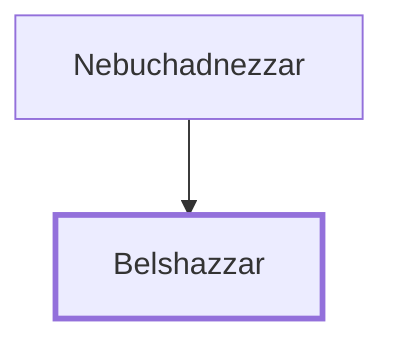

# Belshazzar

The last Emperor of Babylon, son of Nabonidus.

**Original-language names:** בֵּֽלְאשַׁצַּר, בֵּלְשַׁאצַּר (H1112) · בֵּֽלְאשַׁצַּר, בֵּלְשַׁאצַּר (H1113)

## When

- **Placed around:** [[connections/timeline/6th century BC|538 BC]] *(Ussher: the median date of the passages naming them)*
- **Reigned / in office:** c. [[connections/timeline/6th century BC|553 BC]] – [[connections/timeline/6th century BC|539 BC]] *(modern dates)* · Belshazzar, Babylon · [Wikidata Q225198](https://www.wikidata.org/wiki/Q225198) · Co-regent with his father Nabonidus

## Family

- **Father:** [[connections/people/Nebuchadnezzar|Nebuchadnezzar]]
- **Tribe or nation:** Mesopotamia

**Family group:** [[connections/genealogy/Family of Nebuchadnezzar|Family of Nebuchadnezzar]], generation 2

## Appears in

[[connections/chapters/27-daniel/Daniel 5|Daniel 5 (6)]] · [[connections/chapters/27-daniel/Daniel 7|Daniel 7]] · [[connections/chapters/27-daniel/Daniel 8|Daniel 8]]

## Appears in the same verse as

[[connections/people/Daniel (Ezekiel 14.14)|Daniel (Ezekiel 14.14) (3)]] · [[connections/people/Nebuchadnezzar|Nebuchadnezzar]] · [[connections/places/Babylon|Babylon]] · [[connections/places/Jerusalem|Jerusalem]]
