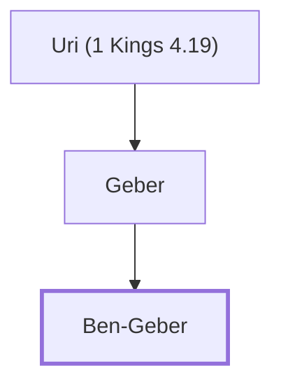

# Ben-Geber

One of Solomon's twelve district governors.

**Original-language names:** בֶּן־גֶּ֫בֶר (H1127)

## When

- **Placed around:** [[connections/timeline/11th century BC|1014 BC]] *(Ussher: the median date of the passages naming them)*

## Family

- **Father:** [[connections/people/Geber|Geber]]

**Line of descent** (3 generations, father to son): [[connections/people/Uri (1 Kings 4.19)|Uri (1 Kings 4.19)]] → [[connections/people/Geber|Geber]] → **Ben-Geber**

**Family group:** [[connections/genealogy/Family of Uri (1 Kings 4.19)|Family of Uri (1 Kings 4.19)]], generation 3

## Appears in

[[connections/chapters/11-1-kings/1 Kings 4|1 Kings 4]]

## Appears in the same verse as

[[connections/people/Jair (Numbers 32.41)|Jair (Numbers 32.41)]] · [[connections/people/Manasseh (Genesis 41.51)|Manasseh (Genesis 41.51)]] · [[connections/places/Argob|Argob]] · [[connections/places/Bashan|Bashan]] · [[connections/places/Gilead|Gilead]] · [[connections/places/Ramoth|Ramoth]]
