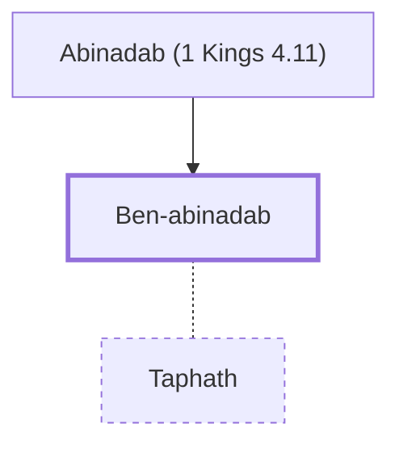

# Ben-abinadab

Solomon's son-in-law, an official in his administration.

**Original-language names:** בֶּן־אֲבִינָדָב (H1125)

## When

- **Placed around:** [[connections/timeline/11th century BC|1014 BC]] *(Ussher: the median date of the passages naming them)*

## Family

- **Father:** [[connections/people/Abinadab (1 Kings 4.11)|Abinadab (1 Kings 4.11)]]
- **Spouses:** [[connections/people/Taphath|Taphath]]

**Family group:** [[connections/genealogy/Family of Abinadab (1 Kings 4.11)|Family of Abinadab (1 Kings 4.11)]], generation 2

## Appears in

[[connections/chapters/11-1-kings/1 Kings 4|1 Kings 4]]

## Appears in the same verse as

[[connections/people/Abinadab (1 Kings 4.11)|Abinadab (1 Kings 4.11)]] · [[connections/people/Solomon|Solomon]] · [[connections/people/Taphath|Taphath]] · [[connections/places/Dor|Dor]]
