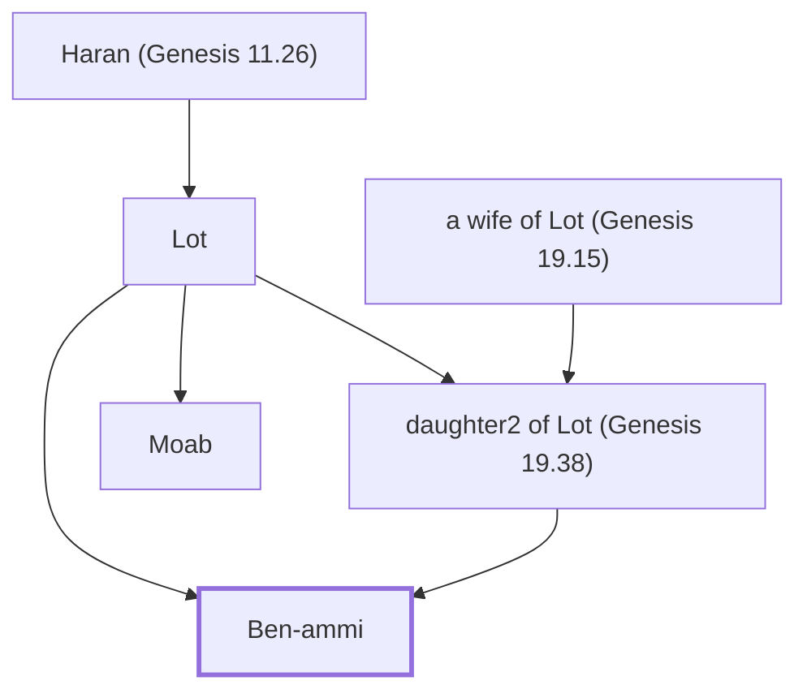

# Ben-ammi

Son of Lot's younger daughter; father of the Ammonites.

**Original-language names:** בֶּן־עַמִּי (H1151)

## When

- **Placed around:** [[connections/timeline/19th century BC|1896 BC]] *(Ussher: the median date of the passages naming them)*

## Family

- **Father:** [[connections/people/Lot|Lot]]
- **Mother:** [[connections/people/daughter2 of Lot (Genesis 19.38)|daughter2 of Lot (Genesis 19.38)]]
- **Brothers and sisters:** [[connections/people/Moab|Moab]]
- **Tribe or nation:** Ammon

**Line of descent** (23 generations, father to son): [[connections/people/Adam|Adam]] → [[connections/people/Seth|Seth]] → [[connections/people/Enosh|Enosh]] → [[connections/people/Kenan|Kenan]] → [[connections/people/Mahalalel (Genesis 5.12)|Mahalalel (Genesis 5.12)]] → [[connections/people/Jared|Jared]] → [[connections/people/Enoch (Genesis 5.18)|Enoch (Genesis 5.18)]] → [[connections/people/Methuselah|Methuselah]] → [[connections/people/Lamech (Genesis 5.25)|Lamech (Genesis 5.25)]] → [[connections/people/Noah (Genesis 5.29)|Noah (Genesis 5.29)]] → [[connections/people/Shem|Shem]] → [[connections/people/Arpachshad|Arpachshad]] → [[connections/people/Cainan|Cainan]] → [[connections/people/Shelah (Genesis 10.24)|Shelah (Genesis 10.24)]] → [[connections/people/Eber (Genesis 10.21)|Eber (Genesis 10.21)]] → [[connections/people/Peleg|Peleg]] → [[connections/people/Reu|Reu]] → [[connections/people/Serug|Serug]] → [[connections/people/Nahor (Genesis 11.22)|Nahor (Genesis 11.22)]] → [[connections/people/Terah|Terah]] → [[connections/people/Haran (Genesis 11.26)|Haran (Genesis 11.26)]] → [[connections/people/Lot|Lot]] → **Ben-ammi**

**Family group:** [[connections/genealogy/Family of Adam|Family of Adam]], generation 23

## Appears in

[[connections/chapters/01-genesis/Genesis 19|Genesis 19]]

## Appears in the same verse as

[[connections/places/Ammon|Ammon]]
