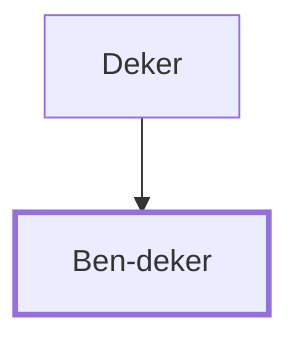

# Ben-deker

One of Solomon's twelve district governors.

**Original-language names:** בֶּן־דֶּ֫קֶר (H1128)

## When

- **Placed around:** [[connections/timeline/11th century BC|1014 BC]] *(Ussher: the median date of the passages naming them)*

## Family

- **Father:** [[connections/people/Deker|Deker]]

**Family group:** [[connections/genealogy/Family of Deker|Family of Deker]], generation 2

## Appears in

[[connections/chapters/11-1-kings/1 Kings 4|1 Kings 4]]

## Appears in the same verse as

[[connections/people/Deker|Deker]] · [[connections/places/Beth-shemesh (Joshua 15.10)|Beth-shemesh (Joshua 15.10)]] · [[connections/places/Elonbeth-hanan|Elonbeth-hanan]] · [[connections/places/Makaz|Makaz]] · [[connections/places/Shaalbim|Shaalbim]]
