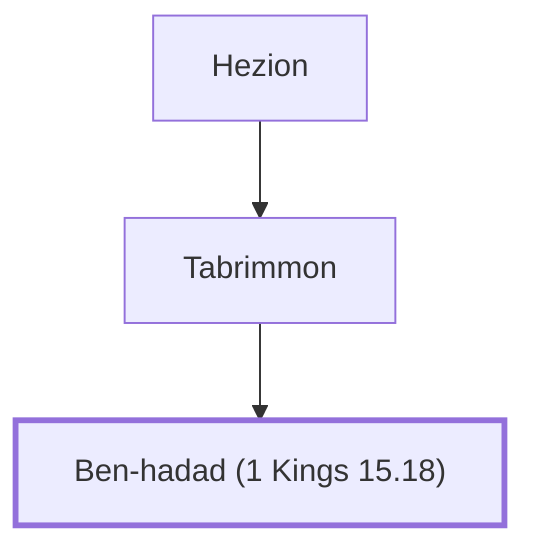

# Ben-hadad (1 Kings 15.18)

King of Aram, contemporary of Asa and Baasha.

**Original-language names:** בֶּן־הֲדַד (H1130)

## When

- **Placed around:** [[connections/timeline/10th century BC|901 BC]] *(Ussher: the median date of the passages naming them)*

## Family

- **Father:** [[connections/people/Tabrimmon|Tabrimmon]]
- **Tribe or nation:** Syria

**Line of descent** (3 generations, father to son): [[connections/people/Hezion|Hezion]] → [[connections/people/Tabrimmon|Tabrimmon]] → **Ben-hadad (1 Kings 15.18)**

**Family group:** [[connections/genealogy/Family of Hezion|Family of Hezion]], generation 3

## Appears in

[[connections/chapters/11-1-kings/1 Kings 15|1 Kings 15 (2)]] · [[connections/chapters/11-1-kings/1 Kings 20|1 Kings 20 (12)]] · [[connections/chapters/14-2-chronicles/2 Chronicles 16|2 Chronicles 16 (2)]] · [[connections/chapters/24-jeremiah/Jeremiah 49|Jeremiah 49]]

## Appears in the same verse as

[[connections/people/Israel|Israel (6)]] · [[connections/places/Syria|Syria (5)]] · [[connections/people/Asa (1 Kings 15.8)|Asa (1 Kings 15.8) (4)]] · [[connections/places/Damascus|Damascus (3)]] · [[connections/places/Samaria|Samaria (3)]] · [[connections/people/Naphtali|Naphtali (2)]] · [[connections/places/Abel-beth-maacah|Abel-beth-maacah (2)]] · [[connections/places/Aphek (1 Kings 20.26)|Aphek (1 Kings 20.26) (2)]] · [[connections/places/Dan|Dan (2)]] · [[connections/places/Ijon|Ijon (2)]] · [[connections/people/Ahab (1 Kings 16.28)|Ahab (1 Kings 16.28)]] · [[connections/people/Hezion|Hezion]] · [[connections/people/Tabrimmon|Tabrimmon]] · [[connections/places/Chinnereth|Chinnereth]]
