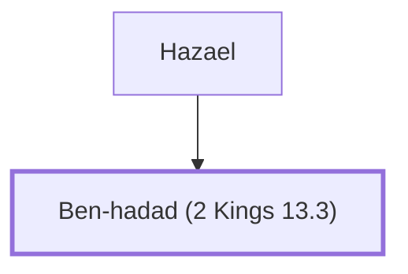

# Ben-hadad (2 Kings 13.3)

King of Aram who oppressed Israel

**Original-language names:** בֶּן־הֲדַד (H1130)

## When

- **Placed around:** [[connections/timeline/9th century BC|836 BC]] *(Ussher: the median date of the passages naming them)*

## Family

- **Father:** [[connections/people/Hazael|Hazael]]
- **Tribe or nation:** Syria

**Family group:** [[connections/genealogy/Family of Hazael|Family of Hazael]], generation 2

## Appears in

[[connections/chapters/12-2-kings/2 Kings 13|2 Kings 13 (3)]] · [[connections/chapters/30-amos/Amos 1|Amos 1]]

## Appears in the same verse as

[[connections/people/Hazael|Hazael (4)]] · [[connections/people/Israel|Israel (2)]] · [[connections/places/Syria|Syria (2)]] · [[connections/people/Jehoahaz (2 Kings 10.35)|Jehoahaz (2 Kings 10.35)]] · [[connections/people/Joash (2 Kings 13.9)|Joash (2 Kings 13.9)]]
