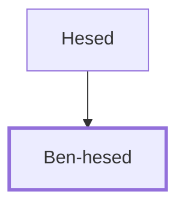

# Ben-hesed

Solomon's officer in Aruboth

**Original-language names:** בֶּן־חֶ֫סֶד (H1136)

## When

- **Placed around:** [[connections/timeline/11th century BC|1014 BC]] *(Ussher: the median date of the passages naming them)*

## Family

- **Father:** [[connections/people/Hesed|Hesed]]

**Family group:** [[connections/genealogy/Family of Hesed|Family of Hesed]], generation 2

## Appears in

[[connections/chapters/11-1-kings/1 Kings 4|1 Kings 4]]

## Appears in the same verse as

[[connections/people/Hesed|Hesed]] · [[connections/places/Arubboth|Arubboth]] · [[connections/places/Hepher|Hepher]] · [[connections/places/Socoh (Joshua 15.35)|Socoh (Joshua 15.35)]]
