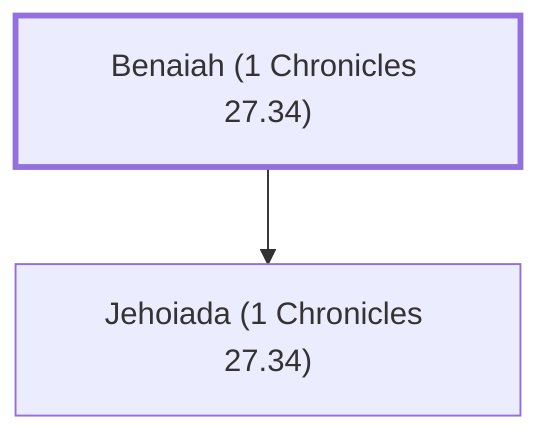

# Benaiah (1 Chronicles 27.34)

Father of Jehoiada, who succeeded Ahithophel as David's counselor.

**Original-language names:** בְּנָיָ֫הוּ (H1141)

## When

- **Placed around:** [[connections/timeline/11th century BC|1015 BC]] *(Ussher: the median date of the passages naming them)*

## Family

- **Children:** [[connections/people/Jehoiada (1 Chronicles 27.34)|Jehoiada (1 Chronicles 27.34)]]

**Family group:** [[connections/genealogy/Family of Benaiah (1 Chronicles 27.34)|Family of Benaiah (1 Chronicles 27.34)]], generation 1

## Appears in

[[connections/chapters/13-1-chronicles/1 Chronicles 27|1 Chronicles 27]]

## Appears in the same verse as

[[connections/people/Abiathar|Abiathar]] · [[connections/people/Ahithophel|Ahithophel]] · [[connections/people/Jehoiada (1 Chronicles 27.34)|Jehoiada (1 Chronicles 27.34)]] · [[connections/people/Joab (1 Samuel 26.6)|Joab (1 Samuel 26.6)]]
