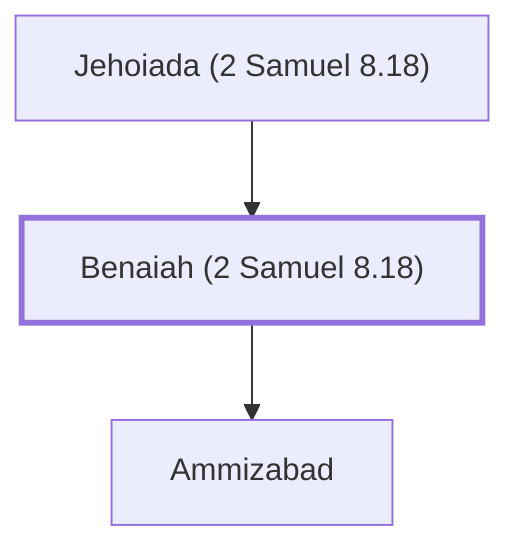

# Benaiah (2 Samuel 8.18)

Son of Jehoiada, a mighty warrior and loyal supporter of David and Solomon.

**Original-language names:** בְּנָיָ֫הוּ (H1141)

## When

- **Placed around:** [[connections/timeline/11th century BC|1015 BC]] *(Ussher: the median date of the passages naming them)*

## Family

- **Father:** [[connections/people/Jehoiada (2 Samuel 8.18)|Jehoiada (2 Samuel 8.18)]]
- **Children:** [[connections/people/Ammizabad|Ammizabad]]

**Family group:** [[connections/genealogy/Family of Jehoiada (2 Samuel 8.18)|Family of Jehoiada (2 Samuel 8.18)]], generation 2

## Appears in

[[connections/chapters/10-2-samuel/2 Samuel 8|2 Samuel 8]] · [[connections/chapters/10-2-samuel/2 Samuel 20|2 Samuel 20]] · [[connections/chapters/10-2-samuel/2 Samuel 23|2 Samuel 23 (2)]] · [[connections/chapters/11-1-kings/1 Kings 1|1 Kings 1 (7)]] · [[connections/chapters/11-1-kings/1 Kings 2|1 Kings 2 (6)]] · [[connections/chapters/11-1-kings/1 Kings 4|1 Kings 4]] · [[connections/chapters/13-1-chronicles/1 Chronicles 11|1 Chronicles 11 (2)]] · [[connections/chapters/13-1-chronicles/1 Chronicles 18|1 Chronicles 18]] · [[connections/chapters/13-1-chronicles/1 Chronicles 27|1 Chronicles 27 (2)]]

## Appears in the same verse as

[[connections/people/Jehoiada (2 Samuel 8.18)|Jehoiada (2 Samuel 8.18) (20)]] · [[connections/people/Zadok (2 Samuel 8.17)|Zadok (2 Samuel 8.17) (7)]] · [[connections/people/Solomon|Solomon (6)]] · [[connections/people/David|David (5)]] · [[connections/people/Nathan (2 Samuel 7.2)|Nathan (2 Samuel 7.2) (5)]] · [[connections/people/Joab (1 Samuel 26.6)|Joab (1 Samuel 26.6) (3)]] · [[connections/people/Abiathar|Abiathar (2)]] · [[connections/people/Ariel (2 Samuel 23.20)|Ariel (2 Samuel 23.20) (2)]] · [[connections/places/Kabzeel|Kabzeel (2)]] · [[connections/places/Moab|Moab (2)]] · [[connections/people/Adonijah (2 Samuel 3.4)|Adonijah (2 Samuel 3.4)]] · [[connections/people/Ammizabad|Ammizabad]] · [[connections/people/Cherethite|Cherethite]] · [[connections/people/Israel|Israel]] · [[connections/people/Rei|Rei]] · [[connections/people/Shimei (1 Kings 1.8)|Shimei (1 Kings 1.8)]] · [[connections/places/Gihon|Gihon]]
