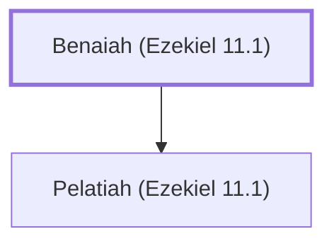

# Benaiah (Ezekiel 11.1)

Father of Pelatiah, a wicked prince of Israel.

**Original-language names:** בְּנָיָ֫הוּ (H1141)

## When

- **Placed around:** [[connections/timeline/6th century BC|594 BC]] *(Ussher: the median date of the passages naming them)*

## Family

- **Children:** [[connections/people/Pelatiah (Ezekiel 11.1)|Pelatiah (Ezekiel 11.1)]]

**Family group:** [[connections/genealogy/Family of Benaiah (Ezekiel 11.1)|Family of Benaiah (Ezekiel 11.1)]], generation 1

## Appears in

[[connections/chapters/26-ezekiel/Ezekiel 11|Ezekiel 11 (2)]]

## Appears in the same verse as

[[connections/people/Pelatiah (Ezekiel 11.1)|Pelatiah (Ezekiel 11.1) (2)]] · [[connections/people/Azzur (Ezekiel 11.1)|Azzur (Ezekiel 11.1)]] · [[connections/people/Israel|Israel]] · [[connections/people/Jaazaniah (Ezekiel 11.1)|Jaazaniah (Ezekiel 11.1)]]
