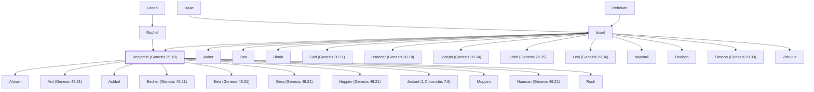

# Benjamin (Genesis 35.18)

Youngest son of Jacob and Rachel

**Also called:** Ben-oni, Jamin, Jeminite

**Original-language names:** בִּנְיָמִין (H1144) · בֶּן־אוֹנִ֑י (H1126) · יָמִין (H3225) · יְמִינִי (H3227b) · Βενιαμίν (G0958)

## When

- **Lived:** [[connections/timeline/18th century BC|1739 BC]] – ? *(Jones)*
- **Placed around:** [[connections/timeline/15th century BC|1406 BC]] *(Ussher: the median date of the passages naming them)*

## Family

- **Father:** [[connections/people/Israel|Israel]]
- **Mother:** [[connections/people/Rachel|Rachel]]
- **Brothers and sisters:** [[connections/people/Asher|Asher]], [[connections/people/Dan|Dan]], [[connections/people/Dinah|Dinah]], [[connections/people/Gad (Genesis 30.11)|Gad (Genesis 30.11)]], [[connections/people/Issachar (Genesis 30.18)|Issachar (Genesis 30.18)]], [[connections/people/Joseph (Genesis 30.24)|Joseph (Genesis 30.24)]], [[connections/people/Judah (Genesis 29.35)|Judah (Genesis 29.35)]], [[connections/people/Levi (Genesis 29.34)|Levi (Genesis 29.34)]], [[connections/people/Naphtali|Naphtali]], [[connections/people/Reuben|Reuben]], [[connections/people/Simeon (Genesis 29.33)|Simeon (Genesis 29.33)]], [[connections/people/Zebulun|Zebulun]]
- **Children:** [[connections/people/Ahiram|Ahiram]], [[connections/people/Ard (Genesis 46.21)|Ard (Genesis 46.21)]], [[connections/people/Ashbel|Ashbel]], [[connections/people/Becher (Genesis 46.21)|Becher (Genesis 46.21)]], [[connections/people/Bela (Genesis 46.21)|Bela (Genesis 46.21)]], [[connections/people/Gera (Genesis 46.21)|Gera (Genesis 46.21)]], [[connections/people/Huppim (Genesis 46.21)|Huppim (Genesis 46.21)]], [[connections/people/Jediael (1 Chronicles 7.6)|Jediael (1 Chronicles 7.6)]], [[connections/people/Muppim|Muppim]], [[connections/people/Naaman (Genesis 46.21)|Naaman (Genesis 46.21)]], [[connections/people/Rosh|Rosh]]
- **Tribe or nation:** Tribe of Benjamin

**Line of descent** (24 generations, father to son): [[connections/people/Adam|Adam]] → [[connections/people/Seth|Seth]] → [[connections/people/Enosh|Enosh]] → [[connections/people/Kenan|Kenan]] → [[connections/people/Mahalalel (Genesis 5.12)|Mahalalel (Genesis 5.12)]] → [[connections/people/Jared|Jared]] → [[connections/people/Enoch (Genesis 5.18)|Enoch (Genesis 5.18)]] → [[connections/people/Methuselah|Methuselah]] → [[connections/people/Lamech (Genesis 5.25)|Lamech (Genesis 5.25)]] → [[connections/people/Noah (Genesis 5.29)|Noah (Genesis 5.29)]] → [[connections/people/Shem|Shem]] → [[connections/people/Arpachshad|Arpachshad]] → [[connections/people/Cainan|Cainan]] → [[connections/people/Shelah (Genesis 10.24)|Shelah (Genesis 10.24)]] → [[connections/people/Eber (Genesis 10.21)|Eber (Genesis 10.21)]] → [[connections/people/Peleg|Peleg]] → [[connections/people/Reu|Reu]] → [[connections/people/Serug|Serug]] → [[connections/people/Nahor (Genesis 11.22)|Nahor (Genesis 11.22)]] → [[connections/people/Terah|Terah]] → [[connections/people/Abraham|Abraham]] → [[connections/people/Isaac|Isaac]] → [[connections/people/Israel|Israel]] → **Benjamin (Genesis 35.18)**

**Family group:** [[connections/genealogy/Family of Adam|Family of Adam]], generation 24

## Events

- [[connections/timeline/18th century BC|1739 BC]] · [[connections/events/Rachel dies giving birth to Benjamin|Rachel dies giving birth to Benjamin]]

## Appears in

[[connections/chapters/01-genesis/Genesis 35|Genesis 35 (2)]] · [[connections/chapters/01-genesis/Genesis 42|Genesis 42 (2)]] · [[connections/chapters/01-genesis/Genesis 43|Genesis 43 (5)]] · [[connections/chapters/01-genesis/Genesis 44|Genesis 44]] · [[connections/chapters/01-genesis/Genesis 45|Genesis 45 (3)]] · [[connections/chapters/01-genesis/Genesis 46|Genesis 46 (2)]] · [[connections/chapters/01-genesis/Genesis 49|Genesis 49]] · [[connections/chapters/02-exodus/Exodus 1|Exodus 1]] · [[connections/chapters/04-numbers/Numbers 1|Numbers 1 (3)]] · [[connections/chapters/04-numbers/Numbers 2|Numbers 2]] · [[connections/chapters/04-numbers/Numbers 7|Numbers 7]] · [[connections/chapters/04-numbers/Numbers 10|Numbers 10]] · [[connections/chapters/04-numbers/Numbers 13|Numbers 13]] · [[connections/chapters/04-numbers/Numbers 26|Numbers 26 (2)]] · [[connections/chapters/04-numbers/Numbers 34|Numbers 34]] · [[connections/chapters/05-deuteronomy/Deuteronomy 27|Deuteronomy 27]] · [[connections/chapters/05-deuteronomy/Deuteronomy 33|Deuteronomy 33]] · [[connections/chapters/06-joshua/Joshua 18|Joshua 18 (4)]] · [[connections/chapters/06-joshua/Joshua 21|Joshua 21 (2)]] · [[connections/chapters/07-judges/Judges 1|Judges 1]] · [[connections/chapters/07-judges/Judges 5|Judges 5]] · [[connections/chapters/07-judges/Judges 10|Judges 10]] · [[connections/chapters/07-judges/Judges 19|Judges 19]] · [[connections/chapters/07-judges/Judges 20|Judges 20 (27)]] · [[connections/chapters/07-judges/Judges 21|Judges 21 (11)]] · [[connections/chapters/09-1-samuel/1 Samuel 4|1 Samuel 4]] · [[connections/chapters/09-1-samuel/1 Samuel 9|1 Samuel 9 (4)]] · [[connections/chapters/09-1-samuel/1 Samuel 10|1 Samuel 10 (3)]] · [[connections/chapters/09-1-samuel/1 Samuel 13|1 Samuel 13 (3)]] · [[connections/chapters/09-1-samuel/1 Samuel 14|1 Samuel 14]] · [[connections/chapters/09-1-samuel/1 Samuel 22|1 Samuel 22]] · [[connections/chapters/10-2-samuel/2 Samuel 2|2 Samuel 2 (4)]] · [[connections/chapters/10-2-samuel/2 Samuel 3|2 Samuel 3]] · [[connections/chapters/10-2-samuel/2 Samuel 4|2 Samuel 4]] · [[connections/chapters/10-2-samuel/2 Samuel 19|2 Samuel 19]] · [[connections/chapters/10-2-samuel/2 Samuel 20|2 Samuel 20]] · [[connections/chapters/10-2-samuel/2 Samuel 21|2 Samuel 21]] · [[connections/chapters/10-2-samuel/2 Samuel 23|2 Samuel 23]] · [[connections/chapters/11-1-kings/1 Kings 4|1 Kings 4]] · [[connections/chapters/11-1-kings/1 Kings 12|1 Kings 12 (2)]] · [[connections/chapters/11-1-kings/1 Kings 15|1 Kings 15]] · [[connections/chapters/13-1-chronicles/1 Chronicles 2|1 Chronicles 2]] · [[connections/chapters/13-1-chronicles/1 Chronicles 6|1 Chronicles 6 (2)]] · [[connections/chapters/13-1-chronicles/1 Chronicles 7|1 Chronicles 7]] · [[connections/chapters/13-1-chronicles/1 Chronicles 8|1 Chronicles 8 (2)]] · [[connections/chapters/13-1-chronicles/1 Chronicles 9|1 Chronicles 9 (2)]] · [[connections/chapters/13-1-chronicles/1 Chronicles 11|1 Chronicles 11]] · [[connections/chapters/13-1-chronicles/1 Chronicles 12|1 Chronicles 12 (3)]] · [[connections/chapters/13-1-chronicles/1 Chronicles 21|1 Chronicles 21]] · [[connections/chapters/13-1-chronicles/1 Chronicles 27|1 Chronicles 27]] · [[connections/chapters/14-2-chronicles/2 Chronicles 11|2 Chronicles 11 (5)]] · [[connections/chapters/14-2-chronicles/2 Chronicles 14|2 Chronicles 14]] · [[connections/chapters/14-2-chronicles/2 Chronicles 15|2 Chronicles 15 (3)]] · [[connections/chapters/14-2-chronicles/2 Chronicles 17|2 Chronicles 17]] · [[connections/chapters/14-2-chronicles/2 Chronicles 25|2 Chronicles 25]] · [[connections/chapters/14-2-chronicles/2 Chronicles 31|2 Chronicles 31]] · [[connections/chapters/14-2-chronicles/2 Chronicles 34|2 Chronicles 34 (2)]] · [[connections/chapters/15-ezra/Ezra 1|Ezra 1]] · [[connections/chapters/15-ezra/Ezra 4|Ezra 4]] · [[connections/chapters/15-ezra/Ezra 10|Ezra 10]] · [[connections/chapters/16-nehemiah/Nehemiah 11|Nehemiah 11 (4)]] · [[connections/chapters/19-psalms/Psalms 68|Psalms 68]] · [[connections/chapters/19-psalms/Psalms 80|Psalms 80]] · [[connections/chapters/24-jeremiah/Jeremiah 1|Jeremiah 1]] · [[connections/chapters/24-jeremiah/Jeremiah 6|Jeremiah 6]] · [[connections/chapters/24-jeremiah/Jeremiah 17|Jeremiah 17]] · [[connections/chapters/24-jeremiah/Jeremiah 32|Jeremiah 32 (2)]] · [[connections/chapters/24-jeremiah/Jeremiah 33|Jeremiah 33]] · [[connections/chapters/24-jeremiah/Jeremiah 37|Jeremiah 37]] · [[connections/chapters/26-ezekiel/Ezekiel 48|Ezekiel 48 (4)]] · [[connections/chapters/28-hosea/Hosea 5|Hosea 5]] · [[connections/chapters/31-obadiah/Obadiah 1|Obadiah 1]] · [[connections/chapters/44-acts/Acts 13|Acts 13]] · [[connections/chapters/45-romans/Romans 11|Romans 11]] · [[connections/chapters/50-philippians/Philippians 3|Philippians 3]] · [[connections/chapters/66-revelation/Revelation 7|Revelation 7]]

## Appears in the same verse as

[[connections/people/Israel|Israel (44)]] · [[connections/people/Judah (Genesis 29.35)|Judah (Genesis 29.35) (33)]] · [[connections/places/Gibeah (Joshua 18.28)|Gibeah (Joshua 18.28) (20)]] · [[connections/places/Jerusalem|Jerusalem (15)]] · [[connections/people/Saul|Saul (14)]] · [[connections/people/Ephraim|Ephraim (11)]] · [[connections/people/Joseph (Genesis 30.24)|Joseph (Genesis 30.24) (11)]] · [[connections/people/Manasseh (Genesis 41.51)|Manasseh (Genesis 41.51) (6)]] · [[connections/people/Simeon (Genesis 29.33)|Simeon (Genesis 29.33) (6)]] · [[connections/people/David|David (5)]] · [[connections/places/Geba|Geba (5)]] · [[connections/people/Abidan|Abidan (4)]] · [[connections/people/Abner|Abner (4)]] · [[connections/people/Asa (1 Kings 15.8)|Asa (1 Kings 15.8) (4)]] · [[connections/people/Bela (Genesis 46.21)|Bela (Genesis 46.21) (4)]] · [[connections/people/Gideoni|Gideoni (4)]] · [[connections/people/Kish (1 Samuel 9.1)|Kish (1 Samuel 9.1) (4)]] · [[connections/people/Rehoboam|Rehoboam (4)]] · [[connections/people/Zebulun|Zebulun (4)]] · [[connections/places/Bethel (Genesis 12.8)|Bethel (Genesis 12.8) (4)]] · [[connections/places/Jordan|Jordan (4)]] · [[connections/places/Negeb|Negeb (4)]] · [[connections/places/Shephelah|Shephelah (4)]] · [[connections/people/Ahiram|Ahiram (3)]] · [[connections/people/Ashbel|Ashbel (3)]] · [[connections/people/Jonathan (1 Samuel 13.2)|Jonathan (1 Samuel 13.2) (3)]] · [[connections/people/Rachel|Rachel (3)]] · [[connections/people/Solomon|Solomon (3)]] · [[connections/places/Anathoth|Anathoth (3)]] · [[connections/places/Gilead|Gilead (3)]] · [[connections/places/Michmash|Michmash (3)]] · [[connections/places/Mizpah|Mizpah (3)]] · [[connections/people/Aaron|Aaron (2)]] · [[connections/people/Becher (Genesis 46.21)|Becher (Genesis 46.21) (2)]] · [[connections/people/Issachar (Genesis 30.18)|Issachar (Genesis 30.18) (2)]] · [[connections/people/Ittai (2 Samuel 23.29)|Ittai (2 Samuel 23.29) (2)]] · [[connections/people/Jeremiah (2 Chronicles 35.25)|Jeremiah (2 Chronicles 35.25) (2)]] · [[connections/people/Jesse|Jesse (2)]] · [[connections/people/Levi (Genesis 29.34)|Levi (Genesis 29.34) (2)]] · [[connections/people/Naphtali|Naphtali (2)]] · [[connections/people/Ribai|Ribai (2)]] · [[connections/people/Samuel|Samuel (2)]] · [[connections/places/Hebron|Hebron (2)]] · [[connections/places/Ramah (Joshua 18.25)|Ramah (Joshua 18.25) (2)]] · [[connections/places/Shiloh|Shiloh (2)]] · [[connections/places/Zela|Zela (2)]] · [[connections/people/Abiel|Abiel]] · [[connections/people/Abraham|Abraham]] · [[connections/people/Amariah (Nehemiah 11.4)|Amariah (Nehemiah 11.4)]] · [[connections/people/Amaziah (2 Kings 12.22)|Amaziah (2 Kings 12.22)]] · [[connections/people/Aphiah|Aphiah]] · [[connections/people/Ard (Genesis 46.21)|Ard (Genesis 46.21)]] · [[connections/people/Asher|Asher]] · [[connections/people/Athaiah|Athaiah]] · [[connections/people/Baanah (2 Samuel 23.29)|Baanah (2 Samuel 23.29)]] · [[connections/people/Baanah (2 Samuel 4.2)|Baanah (2 Samuel 4.2)]] · [[connections/people/Baasha|Baasha]] · [[connections/people/Becorath|Becorath]] · [[connections/people/Benaiah (2 Samuel 23.30)|Benaiah (2 Samuel 23.30)]] · [[connections/people/Bichri|Bichri]] · [[connections/people/Chislon|Chislon]] · [[connections/people/Dan|Dan]] · [[connections/people/Ela|Ela]] · [[connections/people/Eleazar (Exodus 6.23)|Eleazar (Exodus 6.23)]] · [[connections/people/Eliada (2 Chronicles 17.17)|Eliada (2 Chronicles 17.17)]] · [[connections/people/Elidad|Elidad]] · [[connections/people/Gad (Genesis 30.11)|Gad (Genesis 30.11)]] · [[connections/people/Gera (Genesis 46.21)|Gera (Genesis 46.21)]] · [[connections/people/Hanamel|Hanamel]] · [[connections/people/Hebrews|Hebrews]] · [[connections/people/Heleb|Heleb]] · [[connections/people/Hilkiah (2 Kings 22.4)|Hilkiah (2 Kings 22.4)]] · [[connections/people/Hilkiah (Jeremiah 1.1)|Hilkiah (Jeremiah 1.1)]] · [[connections/people/Hodaviah (1 Chronicles 9.7)|Hodaviah (1 Chronicles 9.7)]] · [[connections/people/Huppim (Genesis 46.21)|Huppim (Genesis 46.21)]] · [[connections/people/Iddo (1 Chronicles 27.21)|Iddo (1 Chronicles 27.21)]] · [[connections/people/Ish-bosheth|Ish-bosheth]] · [[connections/people/Ithiel (Nehemiah 11.7)|Ithiel (Nehemiah 11.7)]] · [[connections/people/Jaasiel (1 Chronicles 27.21)|Jaasiel (1 Chronicles 27.21)]] · [[connections/people/Jediael (1 Chronicles 7.6)|Jediael (1 Chronicles 7.6)]] · [[connections/people/Jeshaiah (Nehemiah 11.7)|Jeshaiah (Nehemiah 11.7)]] · [[connections/people/Joab (1 Samuel 26.6)|Joab (1 Samuel 26.6)]] · [[connections/people/Joed|Joed]] · [[connections/people/Kolaiah (Nehemiah 11.7)|Kolaiah (Nehemiah 11.7)]] · [[connections/people/Maaseiah (Nehemiah 11.7)|Maaseiah (Nehemiah 11.7)]] · [[connections/people/Machir (Genesis 50.23)|Machir (Genesis 50.23)]] · [[connections/people/Mahalalel (Nehemiah 11.4)|Mahalalel (Nehemiah 11.4)]] · [[connections/people/Matri|Matri]] · [[connections/people/Meshullam (1 Chronicles 9.7)|Meshullam (1 Chronicles 9.7)]] · [[connections/people/Meshullam (Nehemiah 11.7)|Meshullam (Nehemiah 11.7)]] · [[connections/people/Muppim|Muppim]] · [[connections/people/Naaman (Genesis 46.21)|Naaman (Genesis 46.21)]] · [[connections/people/Oded (2 Chronicles 15.1)|Oded (2 Chronicles 15.1)]] · [[connections/people/Palti (Numbers 13.9)|Palti (Numbers 13.9)]] · [[connections/people/Pedaiah (Nehemiah 11.7)|Pedaiah (Nehemiah 11.7)]] · [[connections/people/Perez|Perez]] · [[connections/people/Phinehas (Exodus 6.25)|Phinehas (Exodus 6.25)]] · [[connections/people/Raphu|Raphu]] · [[connections/people/Rechab (2 Samuel 4.2)|Rechab (2 Samuel 4.2)]] · [[connections/people/Rimmon|Rimmon]] · [[connections/people/Rosh|Rosh]] · [[connections/people/Sallu (1 Chronicles 9.7)|Sallu (1 Chronicles 9.7)]] · [[connections/people/Sallu (Nehemiah 11.7)|Sallu (Nehemiah 11.7)]] · [[connections/people/Sheba (2 Samuel 20.1)|Sheba (2 Samuel 20.1)]] · [[connections/people/Shephatiah (Nehemiah 11.4)|Shephatiah (Nehemiah 11.4)]] · [[connections/people/Shimei (1 Kings 1.8)|Shimei (1 Kings 1.8)]] · [[connections/people/Ulam (1 Chronicles 8.39)|Ulam (1 Chronicles 8.39)]] · [[connections/people/Uzziah (Nehemiah 11.4)|Uzziah (Nehemiah 11.4)]] · [[connections/people/Zechariah (1 Chronicles 27.21)|Zechariah (1 Chronicles 27.21)]] · [[connections/people/Zechariah (Nehemiah 11.4)|Zechariah (Nehemiah 11.4)]] · [[connections/people/Zeror|Zeror]] · [[connections/people/Ziba|Ziba]] · [[connections/places/Ai (Genesis 12.8)|Ai (Genesis 12.8)]] · [[connections/places/Aijalon|Aijalon]] · [[connections/places/Alemeth|Alemeth]] · [[connections/places/Amalek|Amalek]] · [[connections/places/Ammon|Ammon]] · [[connections/places/Beeroth|Beeroth]] · [[connections/places/Beth-aven|Beth-aven]] · [[connections/places/Beth-haccherem|Beth-haccherem]] · [[connections/places/Beth-hoglah|Beth-hoglah]] · [[connections/places/Dan|Dan]] · [[connections/places/Egypt|Egypt]] · [[connections/places/Emek-keziz|Emek-keziz]] · [[connections/places/Esau Mount|Esau Mount]] · [[connections/places/Gerizim Mount|Gerizim Mount]] · [[connections/places/Gibeon|Gibeon]] · [[connections/places/Gilgal (Deuteronomy 11.30)|Gilgal (Deuteronomy 11.30)]] · [[connections/places/Haeleph|Haeleph]] · [[connections/places/Jabesh|Jabesh]] · [[connections/places/Jericho|Jericho]] · [[connections/places/Jezreel (Joshua 19.18)|Jezreel (Joshua 19.18)]] · [[connections/places/Kiriath-jearim|Kiriath-jearim]] · [[connections/places/Manahath|Manahath]] · [[connections/places/Rimmon (Judges 20.45)|Rimmon (Judges 20.45)]] · [[connections/places/Samaria|Samaria]] · [[connections/places/Shaalim|Shaalim]] · [[connections/places/Shalishah|Shalishah]] · [[connections/places/Tekoa|Tekoa]] · [[connections/places/Zelzah|Zelzah]] · [[connections/places/Zorah|Zorah]]
