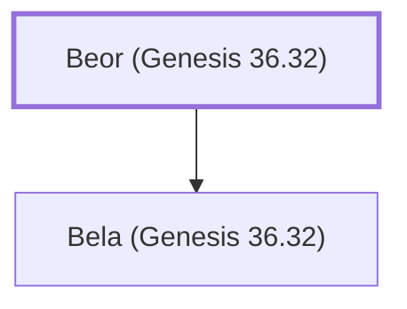

# Beor (Genesis 36.32)

Father of Bela, an Edomite king

**Original-language names:** בְּעוֹר (H1160)

## When

- **Placed around:** [[connections/timeline/18th century BC|1756 BC]] *(Ussher: the median date of the passages naming them)*

## Family

- **Children:** [[connections/people/Bela (Genesis 36.32)|Bela (Genesis 36.32)]]
- **Tribe or nation:** Edom

**Family group:** [[connections/genealogy/Family of Beor (Genesis 36.32)|Family of Beor (Genesis 36.32)]], generation 1

## Appears in

[[connections/chapters/01-genesis/Genesis 36|Genesis 36]] · [[connections/chapters/13-1-chronicles/1 Chronicles 1|1 Chronicles 1]]

## Appears in the same verse as

[[connections/people/Bela (Genesis 36.32)|Bela (Genesis 36.32) (2)]] · [[connections/places/Dinhabah|Dinhabah (2)]] · [[connections/places/Edom|Edom (2)]] · [[connections/people/Israel|Israel]]
