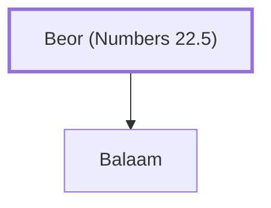

# Beor (Numbers 22.5)

Father of Balaam

**Original-language names:** בְּעוֹר (H1160) · Βοσόρ, Βεώρ (G1007)

## When

- **Placed around:** [[connections/timeline/15th century BC|1451 BC]] *(Ussher: the median date of the passages naming them)*

## Family

- **Children:** [[connections/people/Balaam|Balaam]]

**Family group:** [[connections/genealogy/Family of Beor (Numbers 22.5)|Family of Beor (Numbers 22.5)]], generation 1

## Appears in

[[connections/chapters/04-numbers/Numbers 22|Numbers 22]] · [[connections/chapters/04-numbers/Numbers 24|Numbers 24 (2)]] · [[connections/chapters/04-numbers/Numbers 31|Numbers 31]] · [[connections/chapters/05-deuteronomy/Deuteronomy 23|Deuteronomy 23]] · [[connections/chapters/06-joshua/Joshua 13|Joshua 13]] · [[connections/chapters/06-joshua/Joshua 24|Joshua 24]] · [[connections/chapters/33-micah/Micah 6|Micah 6]] · [[connections/chapters/61-2-peter/2 Peter 2|2 Peter 2]]

## Appears in the same verse as

[[connections/people/Balaam|Balaam (9)]] · [[connections/people/Balak|Balak (2)]] · [[connections/people/Israel|Israel (2)]] · [[connections/places/Egypt|Egypt (2)]] · [[connections/places/Moab|Moab (2)]] · [[connections/places/Pethor|Pethor (2)]] · [[connections/people/Evi|Evi]] · [[connections/people/Hur (Numbers 31.8)|Hur (Numbers 31.8)]] · [[connections/people/Reba|Reba]] · [[connections/people/Rekem (Numbers 31.8)|Rekem (Numbers 31.8)]] · [[connections/people/Zippor|Zippor]] · [[connections/people/Zur (Numbers 31.8)|Zur (Numbers 31.8)]] · [[connections/places/Amaw|Amaw]] · [[connections/places/Euphrates|Euphrates]] · [[connections/places/Gilgal (Deuteronomy 11.30)|Gilgal (Deuteronomy 11.30)]] · [[connections/places/Mesopotamia|Mesopotamia]] · [[connections/places/Midian|Midian]] · [[connections/places/Shittim|Shittim]]
