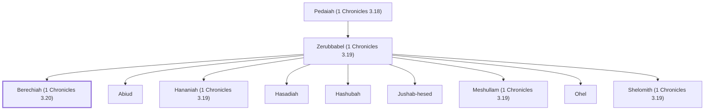

# Berechiah (1 Chronicles 3.20)

Descendant of David through Zerubbabel

**Original-language names:** בֶּרֶכְיָה (H1296)

## When

- **Placed around:** [[connections/timeline/11th century BC|1053 BC]] *(Ussher: the median date of the passages naming them)*

## Family

- **Father:** [[connections/people/Zerubbabel (1 Chronicles 3.19)|Zerubbabel (1 Chronicles 3.19)]]
- **Brothers and sisters:** [[connections/people/Abiud|Abiud]], [[connections/people/Hananiah (1 Chronicles 3.19)|Hananiah (1 Chronicles 3.19)]], [[connections/people/Hasadiah|Hasadiah]], [[connections/people/Hashubah|Hashubah]], [[connections/people/Jushab-hesed|Jushab-hesed]], [[connections/people/Meshullam (1 Chronicles 3.19)|Meshullam (1 Chronicles 3.19)]], [[connections/people/Ohel|Ohel]], [[connections/people/Shelomith (1 Chronicles 3.19)|Shelomith (1 Chronicles 3.19)]]
- **Tribe or nation:** Tribe of Judah

**Line of descent** (56 generations, father to son): [[connections/people/Adam|Adam]] → [[connections/people/Seth|Seth]] → [[connections/people/Enosh|Enosh]] → [[connections/people/Kenan|Kenan]] → [[connections/people/Mahalalel (Genesis 5.12)|Mahalalel (Genesis 5.12)]] → [[connections/people/Jared|Jared]] → [[connections/people/Enoch (Genesis 5.18)|Enoch (Genesis 5.18)]] → [[connections/people/Methuselah|Methuselah]] → [[connections/people/Lamech (Genesis 5.25)|Lamech (Genesis 5.25)]] → [[connections/people/Noah (Genesis 5.29)|Noah (Genesis 5.29)]] → [[connections/people/Shem|Shem]] → [[connections/people/Arpachshad|Arpachshad]] → [[connections/people/Cainan|Cainan]] → [[connections/people/Shelah (Genesis 10.24)|Shelah (Genesis 10.24)]] → [[connections/people/Eber (Genesis 10.21)|Eber (Genesis 10.21)]] → [[connections/people/Peleg|Peleg]] → [[connections/people/Reu|Reu]] → [[connections/people/Serug|Serug]] → [[connections/people/Nahor (Genesis 11.22)|Nahor (Genesis 11.22)]] → [[connections/people/Terah|Terah]] → [[connections/people/Abraham|Abraham]] → [[connections/people/Isaac|Isaac]] → [[connections/people/Israel|Israel]] → [[connections/people/Judah (Genesis 29.35)|Judah (Genesis 29.35)]] → [[connections/people/Perez|Perez]] → [[connections/people/Hezron (Genesis 46.12)|Hezron (Genesis 46.12)]] → [[connections/people/Ram (Ruth 4.19)|Ram (Ruth 4.19)]] → [[connections/people/Amminadab (Exodus 6.23)|Amminadab (Exodus 6.23)]] → [[connections/people/Nahshon|Nahshon]] → [[connections/people/Salmon|Salmon]] → [[connections/people/Boaz|Boaz]] → [[connections/people/Obed (Ruth 4.17)|Obed (Ruth 4.17)]] → [[connections/people/Jesse|Jesse]] → [[connections/people/David|David]] → [[connections/people/Solomon|Solomon]] → [[connections/people/Rehoboam|Rehoboam]] → [[connections/people/Abijah (1 Kings 14.31)|Abijah (1 Kings 14.31)]] → [[connections/people/Asa (1 Kings 15.8)|Asa (1 Kings 15.8)]] → [[connections/people/Jehoshaphat (1 Kings 15.24)|Jehoshaphat (1 Kings 15.24)]] → [[connections/people/Jehoram (1 Kings 22.51)|Jehoram (1 Kings 22.51)]] → [[connections/people/Ahaziah (2 Kings 8.24)|Ahaziah (2 Kings 8.24)]] → [[connections/people/Joash (2 Kings 11.2)|Joash (2 Kings 11.2)]] → [[connections/people/Amaziah (2 Kings 12.22)|Amaziah (2 Kings 12.22)]] → [[connections/people/Uzziah (2 Kings 14.21)|Uzziah (2 Kings 14.21)]] → [[connections/people/Jotham (2 Kings 15.5)|Jotham (2 Kings 15.5)]] → [[connections/people/Ahaz (2 Kings 15.38)|Ahaz (2 Kings 15.38)]] → [[connections/people/Hezekiah (2 Kings 16.20)|Hezekiah (2 Kings 16.20)]] → [[connections/people/Manasseh (2 Kings 20.21)|Manasseh (2 Kings 20.21)]] → [[connections/people/Amon (2 Kings 21.18)|Amon (2 Kings 21.18)]] → [[connections/people/Josiah (1 Kings 13.2)|Josiah (1 Kings 13.2)]] → [[connections/people/Jehoiakim|Jehoiakim]] → [[connections/people/Jehoiachin|Jehoiachin]] → [[connections/people/Shealtiel (1 Chronicles 3.17)|Shealtiel (1 Chronicles 3.17)]] → [[connections/people/Pedaiah (1 Chronicles 3.18)|Pedaiah (1 Chronicles 3.18)]] → [[connections/people/Zerubbabel (1 Chronicles 3.19)|Zerubbabel (1 Chronicles 3.19)]] → **Berechiah (1 Chronicles 3.20)**

**Family group:** [[connections/genealogy/Family of Adam|Family of Adam]], generation 56

## Appears in

[[connections/chapters/13-1-chronicles/1 Chronicles 3|1 Chronicles 3]]

## Appears in the same verse as

[[connections/people/Hasadiah|Hasadiah]] · [[connections/people/Hashubah|Hashubah]] · [[connections/people/Jushab-hesed|Jushab-hesed]] · [[connections/people/Ohel|Ohel]]
